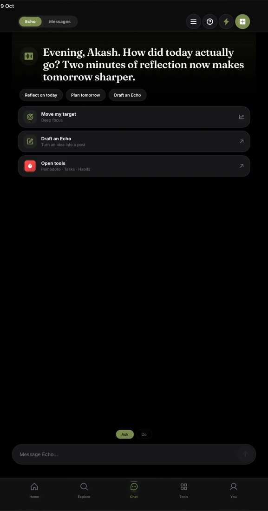
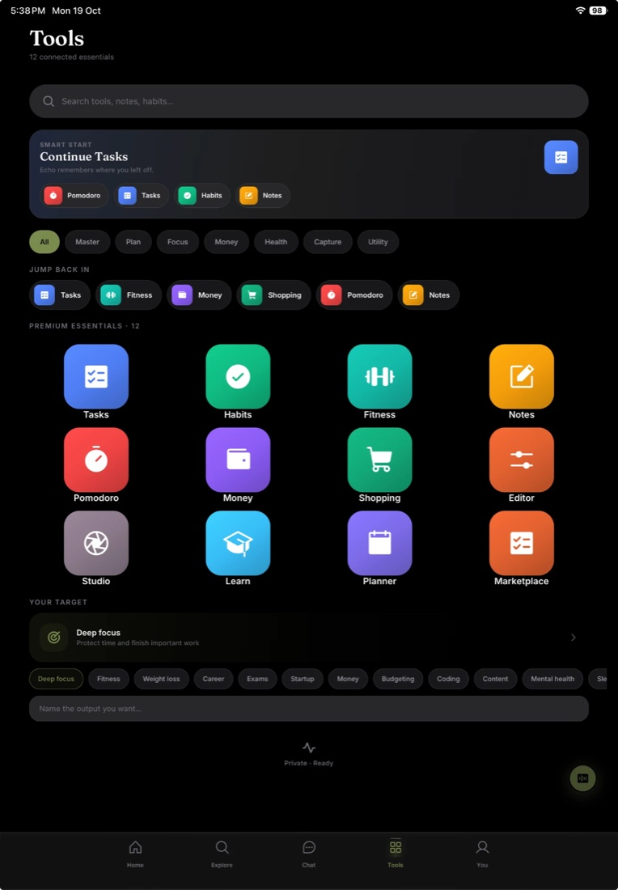
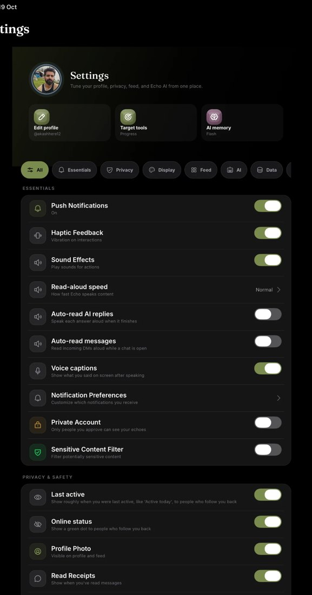
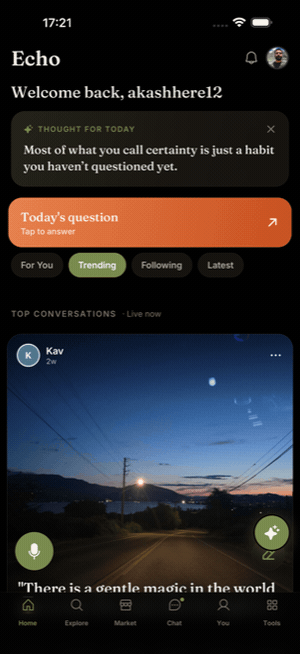
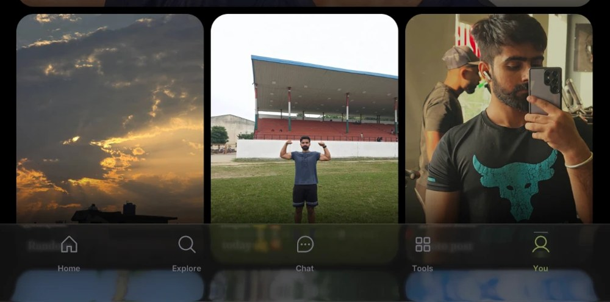
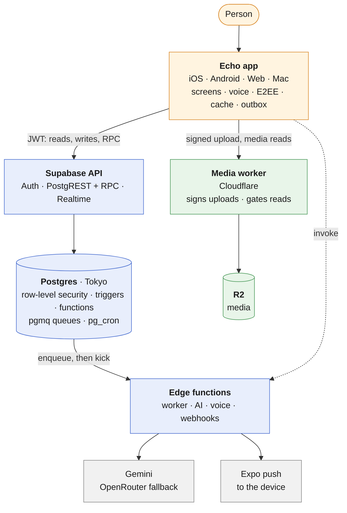

<div align="center">


# Echo

### Speak. Echo does the rest.

**A voice-first social network for India.** One recording becomes a post, a search, or an action, in the
language you speak. English and Hindi at launch, one codebase for iOS, Android, web and Mac, and one-to-one text
messages only the two of you can read.

<p>
<a href="https://github.com/Ak2556/echo-mobile/actions/workflows/ci.yml"></a>


<a href="LICENSE"></a>
</p>

**[Download](https://downloadecho.com)** · **[Architecture](docs/architecture/README.md)** · **[Documentation](docs/README.md)** · **[Contributing](CONTRIBUTING.md)** · **[Security](SECURITY.md)**

<br />

<table>
<tr>
<td align="center"></td>
<td align="center"></td>
<td align="center"></td>
<td align="center"></td>
</tr>
<tr>
<td align="center"><sub>Home</sub></td>
<td align="center"><sub>The assistant</sub></td>
<td align="center"><sub>Everyday tools</sub></td>
<td align="center"><sub>Privacy controls</sub></td>
</tr>
</table>

<br />

<sub>Launching in India in November 2026. Store submission is under way.</sub>

</div>

---

## At a glance

| | |
|---|---|
| **Platforms** | iOS, Android, web and a Mac desktop shell, from one TypeScript codebase |
| **Client** | React Native 0.81, Expo SDK 54, expo-router, TanStack Query, Zustand |
| **Backend** | Supabase: Postgres 17 with row-level security, Auth, Realtime, 24 Deno edge functions |
| **Media** | Cloudflare R2 behind a Worker that signs uploads and gates reads |
| **AI** | Gemini 2.5 directly, OpenRouter as the fallback |
| **Languages** | English and Hindi offered at launch; 26 in the code, switched on as each is properly translated |
| **Sign-in** | Email code, Google, Apple. Minimum age 18 |
| **Status** | Pre-launch: polish, store submission, India first |
| **Licence** | MIT |

## Why Echo exists

Writing a full thought in Devanagari or Tamil on a phone is slow enough that most people simply don't. The
thought gets shortened, or never posted. And apps that *do* translate usually translate the content while leaving an
English interface around it, so the product never feels made for you. Echo starts from the other end.

<table>
<tr>
<td width="33%" valign="top">

### Speak, and it acts

One recording becomes a transcript, an intent and a spoken reply in a **single model call**. Echo posts it,
searches it, opens the tool you asked for, or dictates into the field you are looking at.

19 intents. Every screen is reachable by voice, **enforced by a test**. Navigation never calls the model.

</td>
<td width="33%" valign="top">

### The interface is localised, not just the content

Greeting, tabs, prompts and layout direction all follow the reader. English and Hindi are offered at launch
(`LAUNCH_LANGUAGE_CODES` in `lib/i18n/languages.ts`).

The code carries 26 languages and handles right-to-left layouts. The other 24 translations are not yet good
enough to ship and stay switched off until they are re-translated.

</td>
<td width="33%" valign="top">

### A reason to return that isn't the scroll

One Daily Question, the same for everyone, that **closes**: you answer, you read what the network said, you're
done until tomorrow.

Plus a shelf of everyday tools for the days you have nothing to post.

</td>
</tr>
</table>

<div align="center">



<sub><b>One build.</b> The whole interface follows the reader: English, हिन्दी, العربية.</sub>

</div>

## What it does

| | |
|---|---|
| **Social** | Posts with image and video, comments, reactions, reposts, follows, bookmarks, blocks and mutes. **Private accounts** where following needs approval |
| **Messaging** | One-to-one and group chats. One-to-one text is **end-to-end encrypted**. Read receipts and presence that do what their toggles say |
| **Voice** | Hold to talk. Dictation fills a field and **never submits**, so a mis-transcription cannot publish or reply on its own |
| **AI** | An assistant with tool-calling (Ask and Do modes, with a confirm card before it acts), runtime translation of the interface, and recommendations from what you like |
| **Mini-apps** | 22 everyday tools, including habits, tasks, notes, planner, expenses, fitness and pomodoro, synced across devices |
| **Trust and safety** | Text *and* uploaded images are judged before anything reaches the feed; reports, blocking, a moderator role, statements of reasons and a six-month appeals window |
| **Accessibility** | Labelled controls, a reduced-motion setting wired into the theme's animation helper, and the OS Reduce Transparency setting respected |

### Design language: glass, with a budget

Surfaces are glass: translucent panels over the content beneath. Echo uses **Apple's native Liquid Glass** on
iOS 26 and a hand-built blur-and-highlight glass elsewhere, and treats the effect as something with a performance
budget, not decoration.

| Surface | Used when |
|---|---|
| **Liquid Glass** (`expo-glass-effect`) | iOS 26 and a binary that includes the native module |
| **Shader glass** | High-end devices, on surfaces not re-rendered mid-scroll, with motion allowed |
| **Blur glass** | Anything else that can afford a blur |
| **Solid** | Data saver, Reduce Transparency, low-end devices, or a theme that is not a glass theme |

Accessibility settings are applied before anything else. Surfaces re-rendered per row during a scroll never get
the shader, because a live blur over scrolling content cost about 6 ms of GPU per frame: when an effect and the
frame rate conflict, the effect loses. Native modules are loaded lazily, so a JavaScript update that reaches an
older binary falls back to blur instead of crashing.

<div align="center">



</div>

---

## System design

The summary. [`docs/architecture/`](docs/architecture/README.md) has the full version: seven short pages, sequence
diagrams for every major flow, and a log of each major decision and what it cost.



<sub>**Orange** the device · **blue** Supabase · **green** Cloudflare · **grey** third parties</sub>

### Principles

1. **The database is the rulebook.** Who may read or write what, how often, and what follows are enforced in
   Postgres (row-level security, triggers, functions), not in the app. A modified client can reach exactly what its
   login allows.
2. **Side effects are queued, not chained.** A post, a message or a purchase writes a row and enqueues a job; a
   worker does the slow part, retries it, and dead-letters it if it never succeeds.
3. **Fail closed, and make failure visible.** A post is hidden until moderation passes it; encryption fails the send
   rather than falling back silently; a job that cannot finish lands in a queue a probe reports.
4. **The device works without the network.** Writes that must survive go through an outbox, and server data is
   cached for seven days (never decrypted direct messages: those are not written to disk).
5. **Privacy is built, not promised.** Presence, read receipts, private accounts and erasure are enforced where a
   modified client cannot get around them.

### Stack

| Layer | Choice |
|---|---|
| **App** | React Native 0.81, Expo SDK 54, React 19.1, TypeScript 5.9, expo-router 6. Native projects are generated, never hand-edited |
| **Client state** | TanStack Query 5 persisted to MMKV, Zustand 5, an idempotent outbox |
| **Database** | Postgres 17 with `pgvector`, `pg_trgm`, `pg_cron`, `pg_net`, `pgmq` |
| **API** | Supabase PostgREST and RPC, Auth (email code, Google, Apple), Realtime. Identity is the user's JWT |
| **Server code** | Deno edge functions with pinned imports; they hold the secrets and talk to models and payment providers |
| **Media** | Cloudflare R2 and a Hono Worker; the single place that decides who may upload or read |
| **AI** | Gemini 2.5 directly, OpenRouter as fallback, with a timeout and a circuit breaker |
| **Delivery** | EAS Update (over the air), GitHub Actions, Maestro |
| **Observability** | Sentry and PostHog (both consent-gated), health checks, an outcome probe |

### Trust boundaries

- The client holds only the **anon key** and the user's own **JWT**. The service-role key is in no bundle.
- Everything the client does goes through row-level security. Code that *does* bypass it (the service role,
  `security definer` functions) is kept small, pins its `search_path`, and must check who is calling.
- `anon` is read-only, neither client role can `TRUNCATE`, and new tables start with no client write grants.
- Links that arrive from other people (messages, shared media) open only if they are `https` or `mailto`.

### Where data is readable

| What | Where |
|---|---|
| **Posts, comments, profiles** | By anyone row-level security allows, including signed-out visitors for public content |
| **One-to-one text messages** | **Only on the two devices**, when the recipient has published a key (otherwise the conversation shows no lock). The server stores ciphertext; the keys never leave the device |
| **Media** | In R2. Public buckets are cached; direct-message media is readable only by members of that conversation |
| **Prompts and transcripts** | Sent to Gemini (OpenRouter as fallback) in the United States to be judged or answered |
| **Date of birth and push tokens** | Never selectable by a client; only the owner can write them |

### When things fail

Anything slow, fallible or dependent on an outside service is a **job**: enqueued in the same commit as the row that
needs it, drained by a worker, retried with backoff, and dead-lettered after six attempts.

| If this fails | What happens |
|---|---|
| **The AI model is down, throttled or unfunded** | New posts stay hidden and the job retries. Publishing stops rather than letting unjudged content through |
| **The primary AI provider times out** | The call falls back to OpenRouter behind a circuit breaker |
| **A worker kick is lost or a worker crashes** | A sweeper kicks any queue with ready work within a minute; an in-flight message becomes visible again after 120 s |
| **A job is delivered twice** | Handlers are idempotent: unique keys, client-supplied ids and set-not-toggle writes |
| **A cron job reports healthy while doing nothing** | `cron_health()`, a 15-minute external health check and a 30-minute outcome probe each look for it independently |
| **A bad over-the-air update** | Republish the previous bundle, or flip a feature flag, which takes effect without any release |
| **The database is lost** | A nightly dump plus a recovery bundle that rebuilds an empty database from the repository |
| **The phone is offline** | Writes wait in the outbox and replay, idempotently, when the network returns |

### Delivery

Every change is a pull request with lint, typecheck, tests, CodeQL and secret scanning; the owner merges
explicitly. JavaScript ships over the air; a database migration applies about a minute after merge; edge functions
deploy by hand; native changes need a store build. Over-the-air updates are keyed to a **fingerprint** of everything
native, so an update only reaches builds it is compatible with. See [operations](docs/architecture/06-operations.md).

---

## Engineering you can verify

Each claim points at the thing that enforces it.

| Echo promises | What enforces it | Check it |
|---|---|---|
| **A modified app cannot see or do more than its login allows** | Row-level security on every table, column grants, read-only `anon`. Functions that take a user id check the caller | [`supabase/migrations/`](supabase/migrations/) · `npm run probe:flows` |
| **A post is hidden until it passes moderation** | The row is inserted hidden; only a passing verdict makes it visible, and nobody is notified before then | [Publishing a post](docs/architecture/04-key-flows.md#2-publishing-a-post) |
| **Private messages stay private** | One-to-one text is sealed on the device (XChaCha20-Poly1305, X25519); the server holds ciphertext, and encryption cannot silently fall back | [`lib/e2ee/`](lib/e2ee/) · [design and threat model](docs/design/dm-e2ee.md) |
| **Presence and read receipts expose only what their toggles allow** | One gated function returns an identical answer for "not allowed" and "offline" | [Key flows](docs/architecture/04-key-flows.md#6-presence) |
| **Deleting your account deletes it** | A stored, resumable erasure that reaches the database, object storage and auth, with a probe asserting no row remains | [Deleting an account](docs/architecture/04-key-flows.md#11-deleting-an-account) |
| **It can be rebuilt** | An empty database rebuilds from the repository in about a second; a nightly dump is restore-tested | [`supabase/recovery/`](supabase/recovery/README.md) |
| **Updates reach people safely** | Over-the-air updates keyed to a native fingerprint | [Operations](docs/architecture/06-operations.md#over-the-air-updates-and-the-fingerprint) |

**Tested at three levels:** about 2,550 unit tests, 93 flow probes that run real flows against a local Supabase stack
with throwaway users, and Maestro end-to-end flows on a real release build. Several tests exist to stop a class of
mistake: a voice phrase for every screen, a grant for every selected column, a policy for every upsert, an exact
version for every edge-function import, no raw `Linking.openURL` on untrusted links. See [testing](docs/testing.md).

| What's built | |
|---|---|
| Screens | 95 route files, every one reachable by voice |
| Database | 226 migrations, row-level security on every table |
| Backend | 24 edge functions, job queues and scheduled jobs for the slow work |
| Mini-apps | 22 in the catalog |
| Code | about 116,000 lines of first-party TypeScript |

<sub>Re-derived from the tree on 2026-11-08. Re-derive before quoting.</sub>

---

## Getting started

| Requirement | Version |
|---|---|
| Node | 20 or newer (CI runs 20) |
| Xcode | For iOS builds |
| JDK | **17**, for Android: newer versions fail the CMake step with a misleading message. With `direnv`, `direnv allow` pins it |
| Supabase CLI | For database work and the flow probes |
| Docker | Only for the local Supabase stack |

```bash
git clone https://github.com/Ak2556/echo-mobile.git
cd echo-mobile
npm ci
cp .env.example .env     # add your Supabase URL and anon key
npm start                # then press i, a or w
```

Without Supabase credentials the app starts with remote features switched off, so you can explore the UI.

```bash
npm run lint && npm run typecheck && npm test   # what CI runs
npm run probe:flows       # outcome checks against a local Supabase stack
npm run audit:backend     # call each production RPC for real
npm run i18n:generate     # fill translation gaps from English
```

`android/` and `ios/` are generated by `expo prebuild` and gitignored. **Never edit them**: configure native
behaviour in `app.json`, `app.config.js` and `plugins/`. More in [engineering notes](docs/engineering-notes.md).

## Configuration

Client variables are read at **build time** and are **public in the bundle**: never put a secret in an
`EXPO_PUBLIC_*` variable. Server secrets are set with `supabase secrets set`, never in the app or the repository.

| Variable | Needed for | Notes |
|---|---|---|
| `EXPO_PUBLIC_SUPABASE_URL`, `EXPO_PUBLIC_SUPABASE_ANON_KEY` | Everything remote | Public by design. Without them the app runs with remote features off |
| `SUPABASE_PROJECT_REF` | CLI and scripts | Not read by the app |
| `EXPO_PUBLIC_SENTRY_DSN` | Crash reporting | Consent-gated; optional |
| `EXPO_PUBLIC_POSTHOG_KEY`, `EXPO_PUBLIC_POSTHOG_HOST` | Product analytics | Consent-gated; optional |
| `EXPO_PUBLIC_WEB_BASE_URL` | Links, previews, legal pages | Defaults to `https://downloadecho.com` |
| `EXPO_PUBLIC_SUPPORT_EMAIL`, `EXPO_PUBLIC_DSA_EMAIL` | In-app contact addresses | |

Production builds take these from EAS secrets rather than `.env`. Edge-function secrets (model keys, webhook
secrets) are documented in the header of each function under [`supabase/functions/`](supabase/functions/) and in the
commented section of [`.env.example`](.env.example).

## Troubleshooting

| Symptom | Cause and fix |
|---|---|
| **Android build fails at the CMake step** | A JDK newer than 17. Use JDK 17 |
| **"Posts are not appearing"** | Moderation fails closed. Check the AI key and quota first, then `cron_health()` and the dead-letter queue |
| **AI features fail intermittently** | The AI provider's quota. Failures that look like bugs are often quota |
| **A client write fails with a permission error** | A client `upsert` needs an INSERT **and** an UPDATE policy; a new table has no client grants until you add them |
| **A profile query fails with `42501`** | One column the client selects was never granted, which fails the *whole* select. A test catches it |
| **Tests break after adding a native dependency** | Native modules that throw under Node or jsdom need a stub in `test/stubs/` |
| **An icon is `undefined` at runtime** | A new Phosphor import is missing from the generated shim. Run `node scripts/gen-icon-shim.mjs` |
| **An update does not reach a device** | The device's native fingerprint differs from the update's runtime version. Check the runtime printed when publishing |
| **A migration passes locally but breaks in production** | Local replay is not faithful to production. Validate it against the live schema in a transaction that always rolls back |

## Documentation

| | |
|---|---|
| **[Architecture](docs/architecture/README.md)** | How it is put together, and why |
| **[Engineering notes](docs/engineering-notes.md)** | Repository layout, commands and the gotchas that cost an afternoon |
| **[Testing](docs/testing.md)** | What is tested, and how |
| **[Design docs](docs/README.md)** | End-to-end encryption, presence and read receipts |
| **[Runbooks](docs/runbook/)** | Monitoring and the encryption rollout |
| **[Legal and compliance](docs/compliance/README.md)** | Terms, privacy policy, age policy |

## Status and limitations

Echo is in a polish-and-launch phase: no new features until it is in the stores. After launch: subscriptions once
the free tier demonstrably retains, first-party advertising for regional brands, deeper OS integration (App Intents,
widgets, a share target), and the remaining languages once they are properly translated.

Stated plainly, because each is easy to assume the other way:

| | |
|---|---|
| **End-to-end encryption is one-to-one text only** | Photos, voice, groups and older messages are not encrypted, there is no forward secrecy, and the server still sees who talks to whom. What may be claimed publicly is in the [rollout runbook](docs/runbook/e2ee-rollout.md) |
| **Video is not visually moderated** | Text and still images pass an AI gate; a still-image model cannot read an mp4 |
| **Subscriptions are not wired** | Server hooks exist; the app ships no subscription flow and everyone is on the free plan |
| **Only English and Hindi are offered** | Hindi has been hand-corrected and awaits a native reader's review. The other languages stay off |
| **Some features are built but switched off** | Salons, office hours, stories, quests, badges, Year in Echo and live audio sit behind remote flags that are off in production |
| **Presence and read receipts need a two-device check** | Covered by probes and unit tests; two real phones confirming the dot, the phrase and the toggle are still owed |
| **There is no staging database** | Production is the only hosted database, which is why migrations are validated against the live schema before they merge |

## Contributing, security, support

- **Contributing.** Issues and pull requests are welcome. Read [CONTRIBUTING.md](CONTRIBUTING.md) first: most
  surprises are listed there. The [pull request template](.github/PULL_REQUEST_TEMPLATE.md) asks for an honest
  "Unverified" section. Please follow the [code of conduct](CODE_OF_CONDUCT.md).
- **Security.** Report a vulnerability privately, not in an issue: see [SECURITY.md](SECURITY.md).
- **Support.** [downloadecho.com](https://downloadecho.com), or `support@downloadecho.com`.
- **Legal.** The Terms and Privacy Policy live in code so the app and any web mirror cannot drift apart. Both are
  awaiting counsel sign-off. Minimum age 18; under 18, no advertising and no behavioural profiling, enforced in
  Postgres. Details in [docs/compliance](docs/compliance/README.md).

## Licence and acknowledgements

MIT. See [`LICENSE`](LICENSE).

Echo stands on [Expo](https://expo.dev), [React Native](https://reactnative.dev), [Supabase](https://supabase.com),
[Cloudflare](https://www.cloudflare.com), [TanStack Query](https://tanstack.com/query), [Hono](https://hono.dev),
[Phosphor Icons](https://phosphoricons.com) and many other open-source projects. [`NOTICE`](NOTICE) and
[`sbom.json`](sbom.json) record third-party attribution and licence elections (`npm run legal:sbom`).

---

<div align="center">
<sub>Built by <a href="https://github.com/Ak2556">Akash Thakur</a> · <a href="https://downloadecho.com">downloadecho.com</a></sub>
</div>
