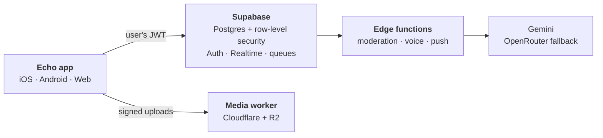

<div align="center">


# Echo

### Speak. Echo does the rest.

**A voice-first social network for India.** Say what is on your mind, in the language you think in. Echo turns it into
a post, a search, or an action.

<p>
<a href="https://github.com/Ak2556/echo-mobile/actions/workflows/ci.yml"></a>


<a href="LICENSE"></a>
</p>

**[Get Echo](https://downloadecho.com)** · [How it works](#how-it-works) · [Privacy](#your-privacy) · [FAQ](#faq) · [For developers](#for-developers-and-contributors)

<br />

<table>
<tr>
<td align="center"></td>
<td align="center"></td>
<td align="center"></td>
</tr>
<tr>
<td align="center"><sub>Home</sub></td>
<td align="center"><sub>The assistant</sub></td>
<td align="center"><sub>Privacy controls</sub></td>
</tr>
</table>

<br />

<sub>Launching in India in November 2026. Store listings go live at launch.</sub>

</div>

---

## Why Echo

Writing a full thought in Devanagari or Tamil on a phone is slow enough that most people simply don't. The thought
gets shortened, or never posted. And apps that *do* translate usually translate the content while leaving an English
interface around it, so the product never feels made for you.

Echo starts from the other end: **you talk, it understands, and the whole app speaks your language.** It is built for
people in India who would rather say it than type it, in English or Hindi first.

## How it works

| | | |
|---|---|---|
| **1. Speak** | Hold the mic and say it the way you would to a friend, in English or Hindi. | Hold to talk, release to send |
| **2. Echo understands** | One request turns your words into a transcript, what you meant, and a spoken reply. Common commands such as opening a screen are handled on the phone with no network at all | Navigation never waits on a model |
| **3. It happens** | Echo posts, searches, opens the screen or tool, or fills the box you are in. Anything significant asks you to confirm first | Dictation never sends on its own |

## What you can do

<table>
<tr>
<td width="33%" valign="top">

### Talk instead of type

Hold to talk. Echo can post what you said, search for it, open the tool you asked for, or type into the box you are
looking at.

Dictation only fills a field. It **never sends on its own**, so a misheard word can't publish or reply for you.

</td>
<td width="33%" valign="top">

### Use it in your language

English and Hindi at launch. The greeting, the tabs, the prompts and the buttons all follow you, not just the posts.

Every screen can be reached by voice.

</td>
<td width="33%" valign="top">

### Come back for one good question

Each day there is one question, the same for everyone. You answer, you read what others said, and you're done until
tomorrow. No endless scroll required.

</td>
</tr>
</table>

<div align="center">


<sub>The whole interface follows the reader: English, हिन्दी, العربية.</sub>

</div>

**And the rest of the app:**

- **Post and connect.** Photos and video, comments, reactions, reposts, follows and bookmarks. Make your account
  private and approve who follows you.
- **Message.** One-to-one and group chats, with read receipts and "online" status you can switch off.
- **Ask the assistant.** *Ask* answers questions; *Do* takes actions for you, and checks with you before anything
  significant.
- **Get things done.** 22 everyday tools in one place: habits, tasks, notes, planner, expenses, fitness, a pomodoro
  timer and more, synced across your devices.
- **Use it anywhere.** iPhone, iPad, Android and the web, from the same account.

## Your privacy

| | |
|---|---|
| **One-to-one text messages are end-to-end encrypted** | Only you and the other person can read them. Echo's servers store scrambled text and never hold the keys |
| **You choose what others see** | Online status and read receipts have switches that really turn them off. Private accounts need your approval to follow |
| **Deleting your account deletes it** | Your data is removed from the database, from file storage and from sign-in, not just hidden |
| **Analytics are opt-in** | Crash reports and usage analytics only run if you agree on the consent screen |
| **18 and over** | Echo is for adults. Age is checked at sign-up |

Being honest about the limits: encryption covers one-to-one **text** only, not photos, voice notes or group chats.
When you use the assistant or voice, your words are sent to Google's Gemini model to be answered, and that processing
happens in the United States. Read the full [Privacy Policy](https://downloadecho.com/privacy).

## Staying safe

Posts and images are checked by an automated moderator before they appear in anyone's feed, so something unsafe
doesn't go out while it waits for review. You can report any post or person, block and mute, and if a decision about
your own content looks wrong, you get the reason in writing and **six months to appeal**.

## FAQ

**Is it free?** Yes. Everyone is on the free plan at launch.

**Which languages?** English and Hindi at launch. The whole interface switches, not only the posts.

**Does it work without internet?** You can read what you have already loaded, and what you write while offline is saved
and sent when the connection returns. Voice commands that need the assistant need a connection.

**Who can see my messages?** In a one-to-one chat, only you and the other person. See [Your privacy](#your-privacy)
for what that does and does not cover.

**Which devices?** iPhone, iPad, Android and the web, from one account.

**Can I delete everything?** Yes: *Settings → Delete account* removes your data, not just your profile.

**Is the code open?** Yes, MIT-licensed, in this repository.

## Help

- **Questions or problems:** [downloadecho.com](https://downloadecho.com) or `support@downloadecho.com`.
- **Found a security issue?** Please report it privately: see [SECURITY.md](SECURITY.md).

---

## For developers and contributors

Echo is open source (MIT). One TypeScript codebase ships to iOS, Android, web and a Mac desktop shell.

| | |
|---|---|
| **App** | React Native 0.81, Expo SDK 54, expo-router, TanStack Query, Zustand |
| **Backend** | Supabase (Postgres with row-level security, Auth, Realtime, Deno edge functions) |
| **Media** | Cloudflare R2 behind a Worker |
| **AI** | Gemini 2.5, with OpenRouter as the fallback |



The database enforces the rules (who can read or write what), slow work runs as retried queue jobs, and a post stays
hidden until moderation passes it. Details in the [architecture](docs/architecture/README.md).

```bash
git clone https://github.com/Ak2556/echo-mobile.git && cd echo-mobile
npm ci && cp .env.example .env     # add your Supabase URL and anon key
npm start                          # then press i, a or w
```

Without Supabase credentials the app starts with remote features switched off, so you can explore the UI.

| Read next | |
|---|---|
| **[Development guide](docs/development.md)** | Requirements, configuration, everyday commands, troubleshooting |
| **[Architecture](docs/architecture/README.md)** | How it is put together and why, with diagrams of every major flow |
| **[Contributing](CONTRIBUTING.md)** | The rules a pull request follows. Read this before opening one |
| **[Testing](docs/testing.md)** | What is tested and how |
| **[Documentation index](docs/README.md)** | Everything else, including runbooks and design notes |

## Status and roadmap

Echo is feature-complete for launch and in a polish-and-submit phase. After launch, in this order: subscriptions once
the free tier retains people, regional advertising, deeper OS integration (Siri and Shortcuts, widgets), and more
languages once each is properly translated. Some built features (salons, stories, quests, badges) are switched off
until they are ready.

## Licence

MIT. See [`LICENSE`](LICENSE). Echo stands on [Expo](https://expo.dev), [React Native](https://reactnative.dev),
[Supabase](https://supabase.com), [Cloudflare](https://www.cloudflare.com) and many other open-source projects;
[`NOTICE`](NOTICE) records the attributions.

---

<div align="center">
<sub>Built by <a href="https://github.com/Ak2556">Akash Thakur</a> · <a href="https://downloadecho.com">downloadecho.com</a></sub>
</div>
