<div align="center">


# Echo

### Speak. Echo does the rest.

**A voice-first social network for India.** One recording becomes a post, a search, or an action, in the
language you speak. 26 languages, one codebase for iOS, Android, web and Mac, and one-to-one text messages
only the two of you can read.

<p>
<a href="https://github.com/Ak2556/echo-mobile/actions/workflows/ci.yml"></a>


<a href="LICENSE"></a>
</p>

**[Download](https://downloadecho.com)** · **[Architecture](docs/architecture/README.md)** · **[Documentation](docs/README.md)** · **[Contributing](CONTRIBUTING.md)** · **[Security](SECURITY.md)**

<br />

<table>
<tr>
<td align="center"></td>
<td align="center">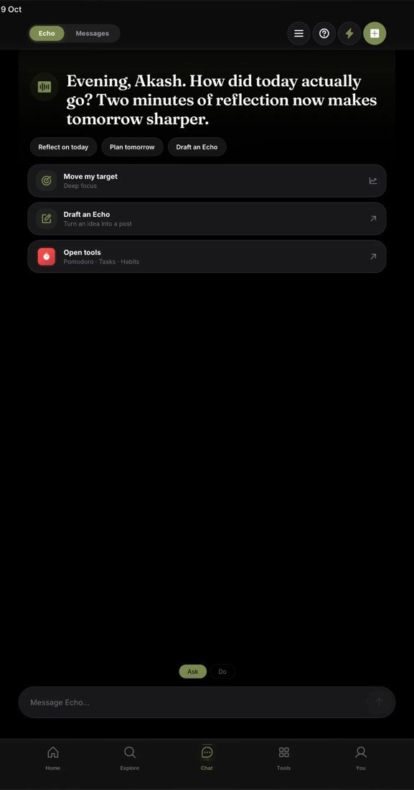</td>
<td align="center">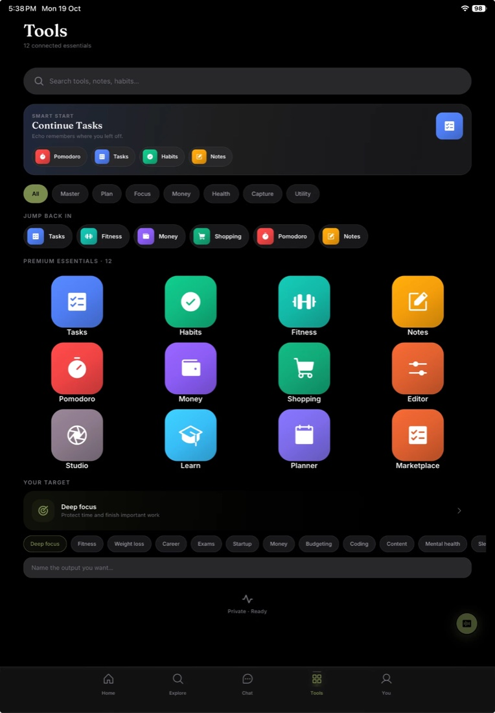</td>
<td align="center">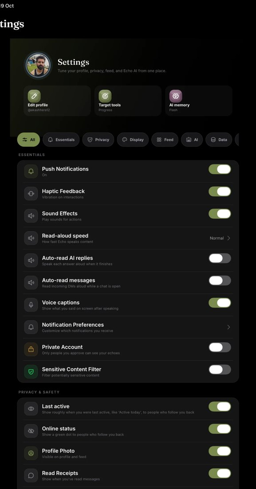</td>
</tr>
<tr>
<td align="center"><sub>Home</sub></td>
<td align="center"><sub>The assistant</sub></td>
<td align="center"><sub>Everyday tools</sub></td>
<td align="center"><sub>Privacy controls</sub></td>
</tr>
</table>

<br />

<sub>Private beta with 20 testers across ten age groups. Store submission next.</sub>

</div>

---

## At a glance

| | |
|---|---|
| **Platforms** | iOS, Android, web and a Mac desktop shell, from one TypeScript codebase |
| **Client** | React Native 0.81, Expo SDK 54, expo-router, TanStack Query, Zustand |
| **Backend** | Supabase: Postgres 17 with row-level security, Auth, Realtime, 24 Deno edge functions |
| **Media** | Cloudflare R2 behind a Worker that signs uploads and gates reads |
| **AI** | Gemini 2.5 directly, OpenRouter as the fallback |
| **Languages** | 26 (13 Indian, 13 global), including right-to-left layouts |
| **Design** | Glass surfaces: Apple's native Liquid Glass on iOS 26, glassmorphism elsewhere, within a performance budget |
| **Status** | Private beta; polish and store submission; India first |
| **Licence** | MIT |

## Contents

[Why Echo exists](#why-echo-exists) · [What it does](#what-it-does) · [Design language](#design-language-glass-with-a-budget) · **[System design](#system-design)**
([overview](#overview) · [principles](#design-principles) · [stack](#technology-stack) ·
[trust boundaries](#trust-boundaries) · [data model](#data-model) · [data flow](#data-flow) ·
[reliability](#reliability-when-things-fail) · [delivery](#delivery-pipeline) ·
[performance](#performance-characteristics) · [flows](#flows-in-detail)) ·
[Production readiness](#production-readiness) · [Engineering you can verify](#engineering-you-can-verify) ·
[Getting started](#getting-started) · [Configuration](#configuration) · [Troubleshooting](#troubleshooting) ·
[Documentation](#documentation) · [Status and roadmap](#status-and-roadmap) ·
[Contributing, security, support](#contributing-security-support) · [Licence](#licence-and-acknowledgements)

---

## Why Echo exists

Writing a full thought in Devanagari or Tamil on a phone is slow enough that most people simply don't. The
thought gets shortened, or never posted. And apps that *do* translate usually translate the content while
leaving an English interface around it, so the product never feels made for you.

Echo starts from the other end.

<table>
<tr>
<td width="33%" valign="top">

### Speak, and it acts

One recording becomes a transcript, an intent and a spoken reply in a **single model call**. Echo posts it,
searches it, opens the tool you asked for, or dictates into the field you are looking at.

19 intents. Every screen is reachable by voice, **enforced by a test**. Navigation never calls the model.

</td>
<td width="33%" valign="top">

### The interface is localised, not just the content

Greeting, tabs, prompts and layout direction all follow the reader. The same build renders left to right
in Hindi and right to left in Arabic.

26 languages: 13 Indian, 13 global.

</td>
<td width="33%" valign="top">

### A reason to return that isn't the scroll

One Daily Question, the same for everyone, that **closes**: you answer, you read what the network said,
you're done until tomorrow.

Plus a shelf of everyday tools for the days you have nothing to post.

</td>
</tr>
</table>

<div align="center">

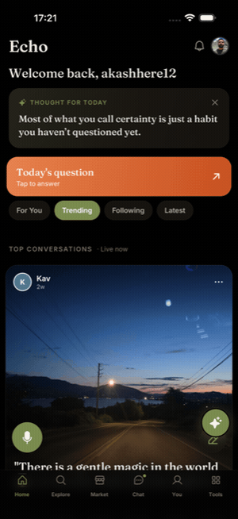

<sub><b>One build.</b> The whole interface follows the reader: English, हिन्दी, العربية.</sub>

</div>

<details>
<summary><b>More screens</b></summary>

<div align="center">

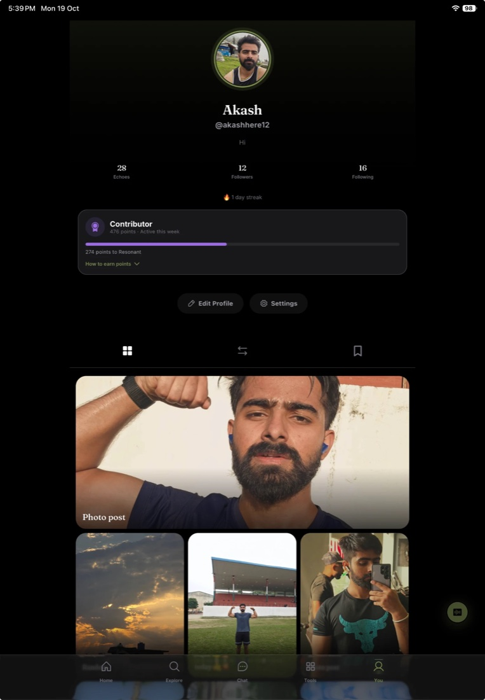
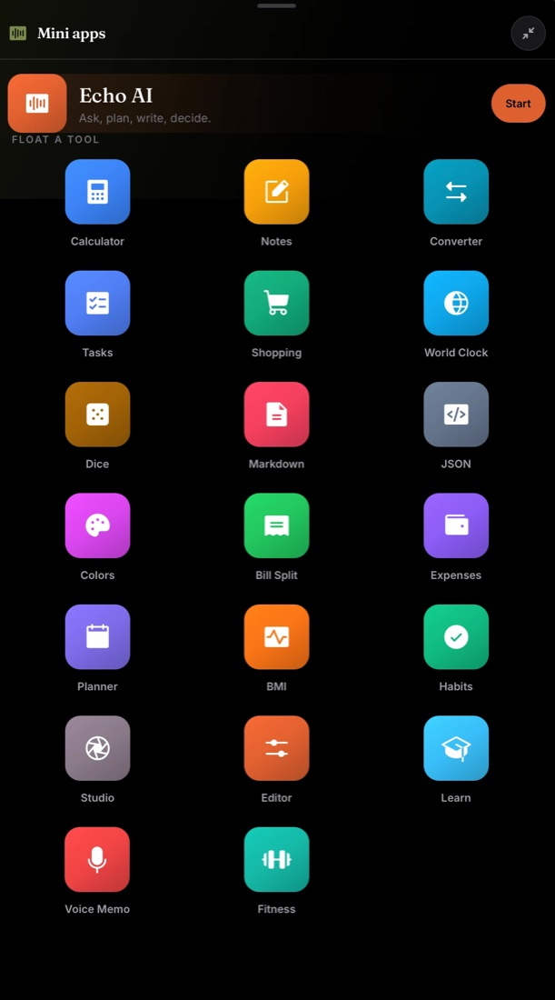

<sub>A profile with its rank · the floating mini-app panel</sub>

</div>

</details>

## What it does

| | |
|---|---|
| **Social** | Posts with image and video, comments, reactions, reposts, follows, bookmarks, blocks and mutes. **Private accounts** where following needs approval |
| **Messaging** | One-to-one and group chats. One-to-one text is **end-to-end encrypted**. Read receipts and presence that do what their toggles say |
| **Voice** | Hold to talk. Dictation fills a field and **never submits**, so a mis-transcription cannot publish or reply on its own |
| **AI** | An assistant with tool-calling, runtime translation of the interface, and recommendations from what you like |
| **Mini-apps** | Habits, tasks, notes, planner, expenses, fitness, pomodoro and more, synced across devices |
| **Trust and safety** | Text *and* uploaded images are judged before anything reaches the feed; reports, a moderator role, statements of reasons and a six-month appeals window |
| **Accessibility** | Accessibility labels and roles in 99 screens and components, and a reduced-motion setting wired into the theme's animation helper |

## Design language: glass, with a budget

Echo's surfaces are glass: translucent panels that let the content beneath show through, with a lit rim. It uses
**Apple's native Liquid Glass** where the device has it and a hand-built **glassmorphism** everywhere else, and it
treats the effect as something with a performance budget, not decoration. Glass is used across 56 screens and
components.

<div align="center">

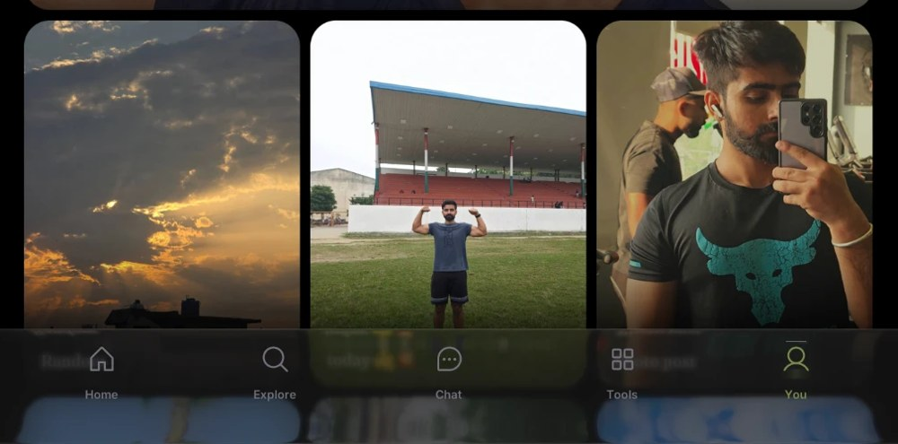

<sub>The tab bar is a glass surface: the post grid blurs through it.</sub>

</div>

| Surface | What it is | When it is used |
|---|---|---|
| **Liquid Glass** (iOS 26) | Apple's real glass (`UIGlassEffect`, through `expo-glass-effect`), which genuinely refracts what is behind it. Adjacent panes **merge like liquid**, the way Apple's own grouped controls do | Wherever iOS 26 and a binary that includes the native module are present. It replaces the two tiers below |
| **Shader glass** | The blur and tinted fill below, plus a Skia shader that draws the refractive rim: edge refraction, colour dispersion, and a dark contact line that separates glass from a decal | High-end devices, on surfaces that are not re-rendered mid-scroll, with motion allowed |
| **Blur glass** | Glassmorphism: a blur, a tinted translucent fill, a bevel border and a top highlight | Anything else that can afford a blur |
| **Solid** | An opaque surface: no blur, no per-frame work | Data saver, the OS Reduce Transparency setting, low-end devices, or a theme that is not a glass theme |

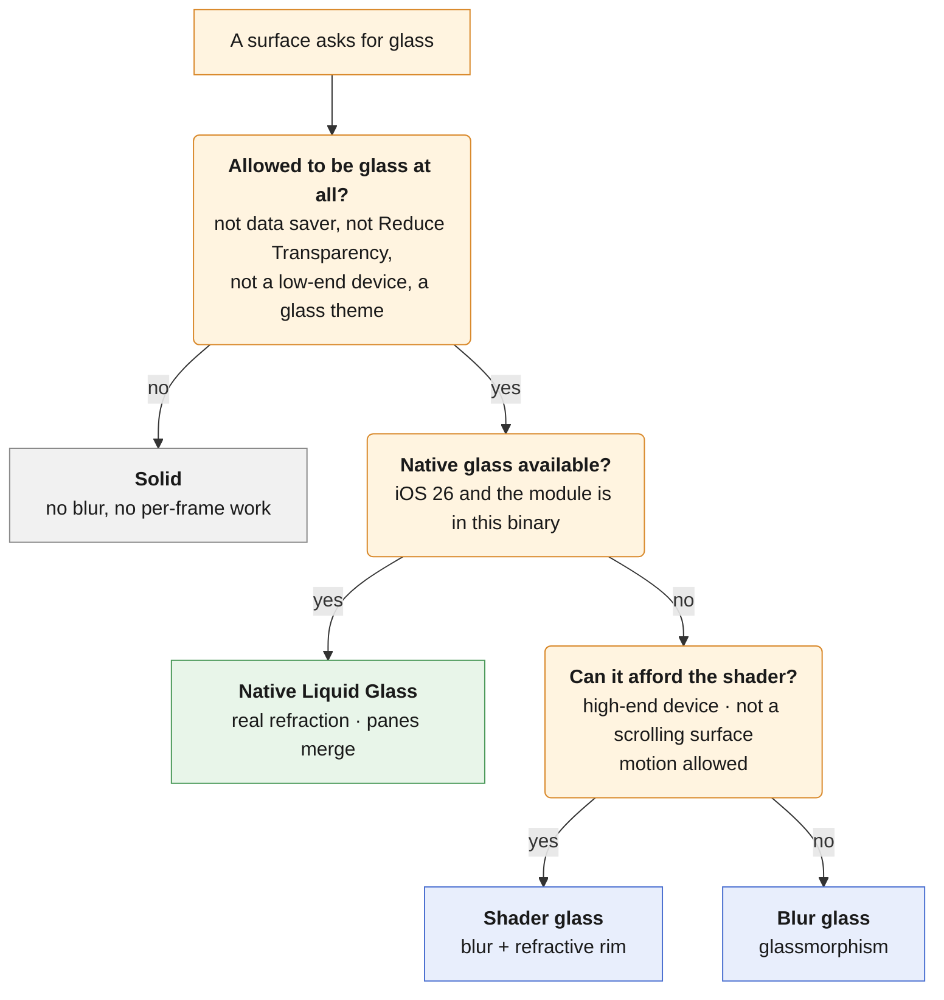

Why it is built this way:

- **Honest about what a shader can do.** A Skia effect cannot sample the React Native views behind it, so it cannot
  truly refract them. The blur underneath does the obscuring and the shader supplies the light response. Real
  refraction comes only from the native glass, and the code says so rather than pretending otherwise.
- **Accessibility comes first.** The OS Reduce Transparency and Reduce Motion settings, and data saver, are
  applied before anything else, and the animated shader never runs when motion is reduced.
- **Performance beats effect.** Surfaces re-rendered per row during a scroll never get the shader, because a live blur
  over scrolling content was measured at about 6 ms of GPU per frame. When an effect and the frame rate conflict, the
  effect loses.
- **Safe to ship over the air.** Both native modules are loaded lazily and guarded, so a JavaScript update that
  reaches an older binary falls back to blur instead of crashing at launch.

---

## System design

This is the summary. [`docs/architecture/`](docs/architecture/README.md) has the full version: seven short
pages, twelve sequence diagrams and a log of every major decision and what it cost.

### Overview

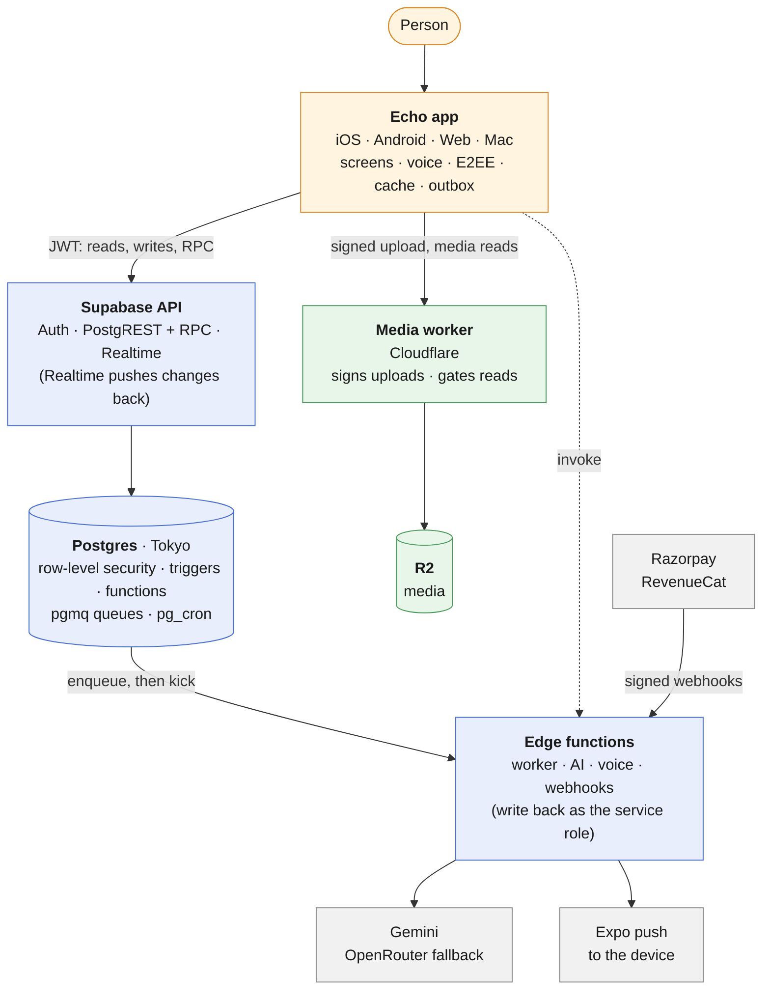

<sub>**Orange** the device · **blue** Supabase · **green** Cloudflare · **grey** third parties</sub>

### Design principles

1. **The database is the rulebook.** Who may read or write what, how often, and what follows are enforced in
   Postgres (row-level security, triggers, functions), not in the app. A modified client can reach exactly
   what its login allows.
2. **Side effects are queued, not chained.** A post, a message or a purchase writes a row and enqueues a job;
   a worker does the slow part, retries it, and dead-letters it if it never succeeds.
3. **Fail closed, and make failure visible.** A post is hidden until moderation passes it; encryption fails the
   send rather than falling back silently; a job that cannot finish lands in a queue a probe reports.
4. **The device works without the network.** Writes that must survive go through an outbox, and server data is
   cached for seven days.
5. **Privacy is built, not promised.** Presence, read receipts, private accounts and erasure are enforced where a
   modified client cannot get around them.

### Technology stack

| Layer | Choice | Why |
|---|---|---|
| **App** | React Native 0.81.5, Expo SDK 54, React 19.1, TypeScript 5.9, expo-router 6 | Four platforms from one team; native configuration is generated, never hand-edited |
| **Client state** | TanStack Query 5 (persisted to MMKV), Zustand 5, an idempotent outbox | One caching model, instant first paint, writes that survive a dead connection |
| **Database** | Postgres 17.6 with `pgvector`, `pg_trgm`, `pg_cron`, `pg_net`, `pgmq` | The schema is the API; rules, queues and schedules live next to the data |
| **API** | Supabase PostgREST and RPC, Auth (OTP, Google, Apple, PKCE), Realtime | No service layer to write or secure; identity is the user's JWT |
| **Server code** | Deno edge functions, `supabase-js` pinned to 2.45.4 | Holds the secrets and talks to models and payment providers; small, and each function authenticates its caller |
| **Media** | Cloudflare R2, a Hono Worker with `aws4fetch` | Cheap storage with free egress; the Worker is the single place that decides who may upload or read |
| **AI** | Gemini 2.5 directly, OpenRouter as fallback, 25 s timeout and a circuit breaker | Fast and cheap on the primary path; a quota or an outage does not stop the app |
| **Delivery** | EAS Update (over the air), GitHub Actions, Maestro | JavaScript reaches users in minutes, keyed to a native fingerprint |
| **Observability** | Sentry, PostHog (both consent-gated), health checks, an outcome probe | Crashes and product signals, plus checks that ask whether the product works |

### Trust boundaries

Who is trusted with what is the most important fact about the system.

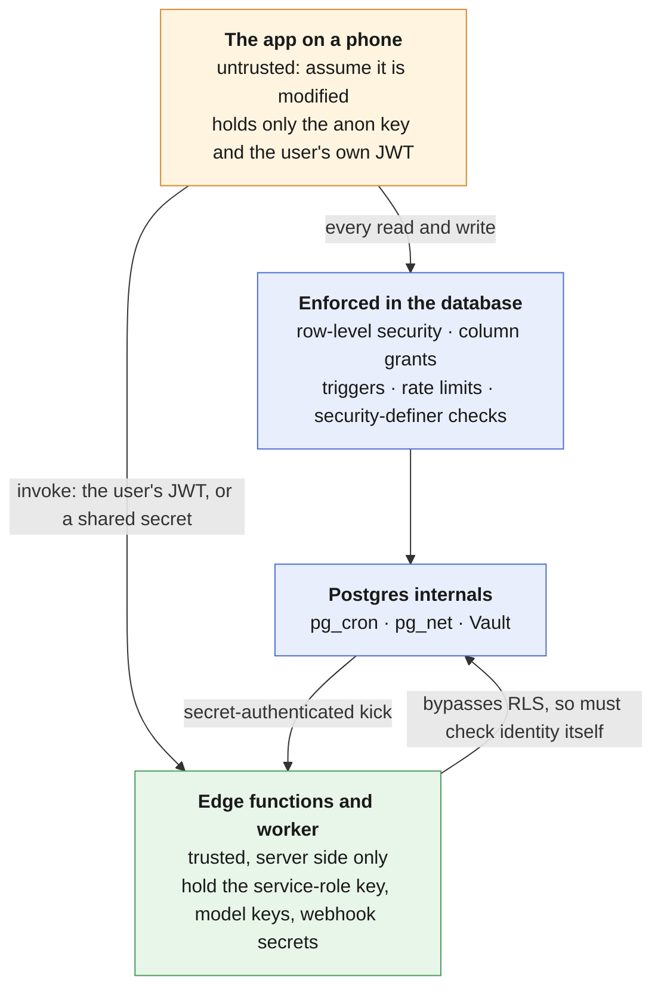

- The client holds only the **anon key** and the user's own **JWT**. The service-role key is in no bundle.
- Everything the client does goes through RLS. Code that *does* bypass it (the service role, `security definer`
  functions) is kept small, pins its `search_path`, and must check who is calling.
- `anon` is read-only; neither client role can `TRUNCATE`; new tables start with no client write grants.

### Data model

95 tables in `public`, row-level security on all of them. The core of the social model:

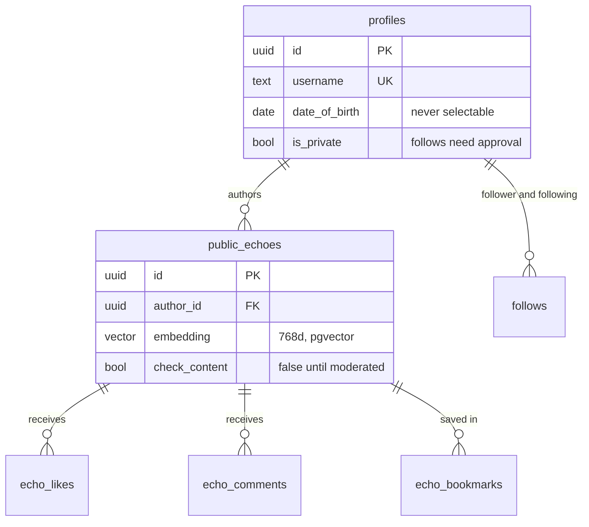

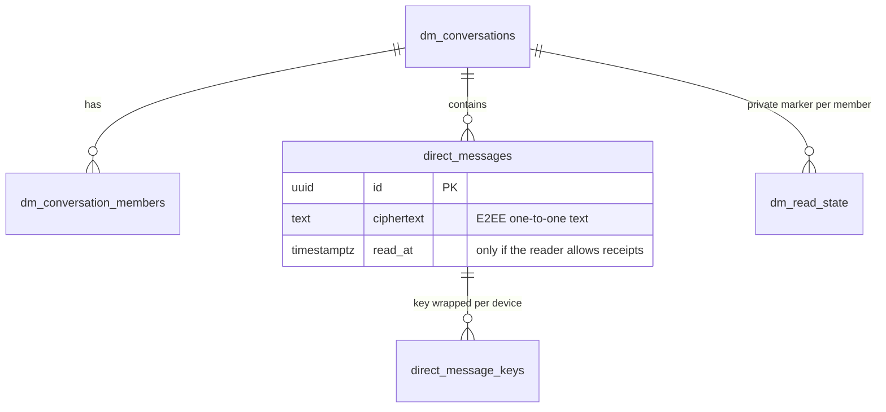

The chain from reports to moderation decisions to appeals, and the other 80-odd tables, are grouped by purpose in the [backend page](docs/architecture/03-backend-and-data.md#the-data-model).

### Data flow

Where data goes, what travels with it, and where it is readable. Read the labels as the *content* of each arrow.

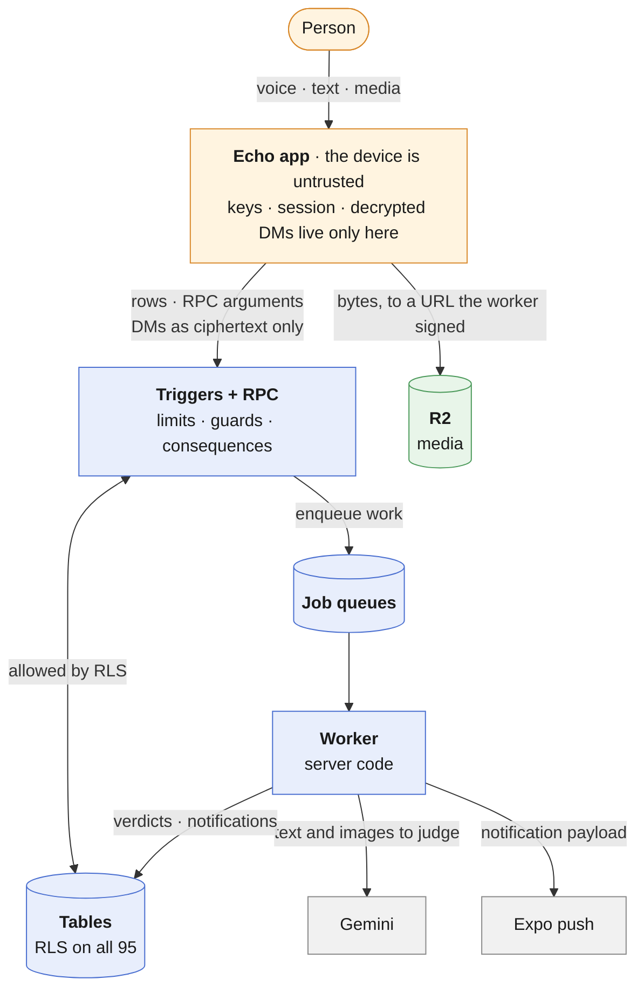

| What | Where it is readable |
|---|---|
| **Posts, comments, profiles** | By anyone the database's row-level security allows, including signed-out visitors for public content |
| **One-to-one text messages** | **Only on the two devices**, when the recipient has published a key (otherwise the conversation shows no lock). The server stores ciphertext and the keys never leave the device |
| **Media** | In R2. Public buckets are cached; direct-message media is readable only by members of that conversation |
| **Prompts and transcripts** | Sent to Gemini (OpenRouter as fallback) in the United States to be judged or answered |
| **Date of birth and push tokens** | Never selectable by a client; only the owner can write them |

### Reliability: when things fail

Anything slow, fallible or dependent on an outside service is a **job**: enqueued in the same commit as the row
that needs it, drained by a worker, retried, and dead-lettered if it never succeeds.

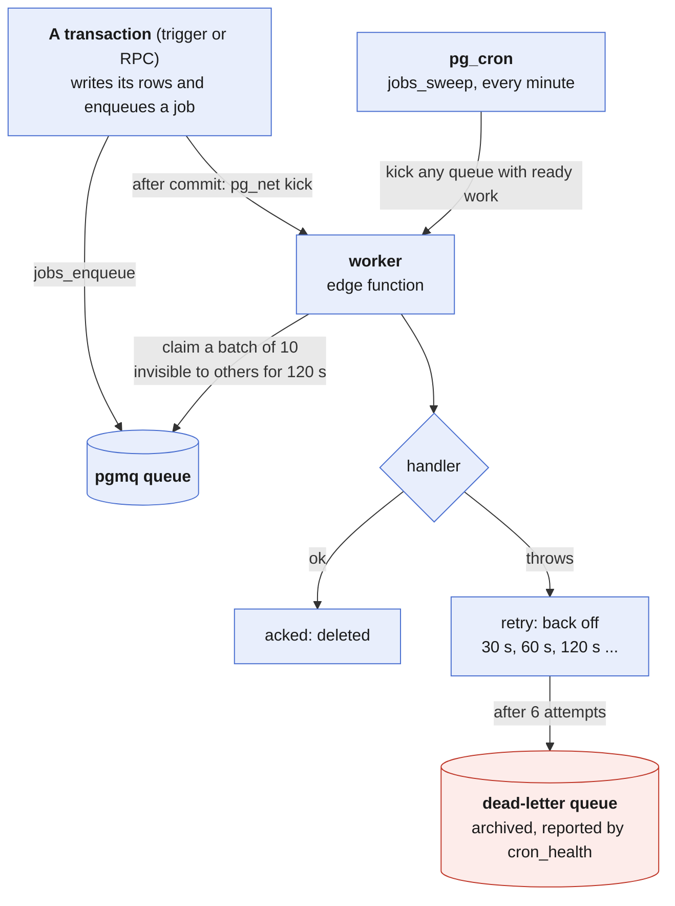

| If this fails | What happens |
|---|---|
| **The AI model is down, throttled or unfunded** | New posts stay hidden and the job retries with backoff (up to six attempts, then the dead-letter queue). Publishing stops rather than letting unjudged content through |
| **The primary AI provider times out** (25 s) | The call falls back to OpenRouter behind a circuit breaker |
| **A worker kick is lost** | The sweeper kicks any queue with ready work within a minute |
| **A worker crashes mid-job** | The message's 120 s visibility lapses and it is retried; nothing is lost |
| **Push delivery fails** | Retried with backoff; a partial delivery is reported, not retried (it would buzz the other devices twice); a push older than six hours is dropped because the in-app inbox still has it |
| **A job is delivered twice** | Handlers are idempotent: unique keys, client-supplied ids and set-not-toggle writes make a repeat a no-op |
| **A cron job reports healthy while doing nothing** | `cron_health()`, a 15-minute external health check and a 30-minute outcome probe each look for it independently |
| **A bad over-the-air update** | Republish the previous bundle, or flip a feature flag, which takes effect without any release |
| **The database is lost** | A nightly dump (restore-tested) plus a recovery bundle that rebuilds an empty database from the repository |
| **The phone is offline** | Writes wait in the outbox and replay, idempotently, when the network returns |

### Delivery pipeline

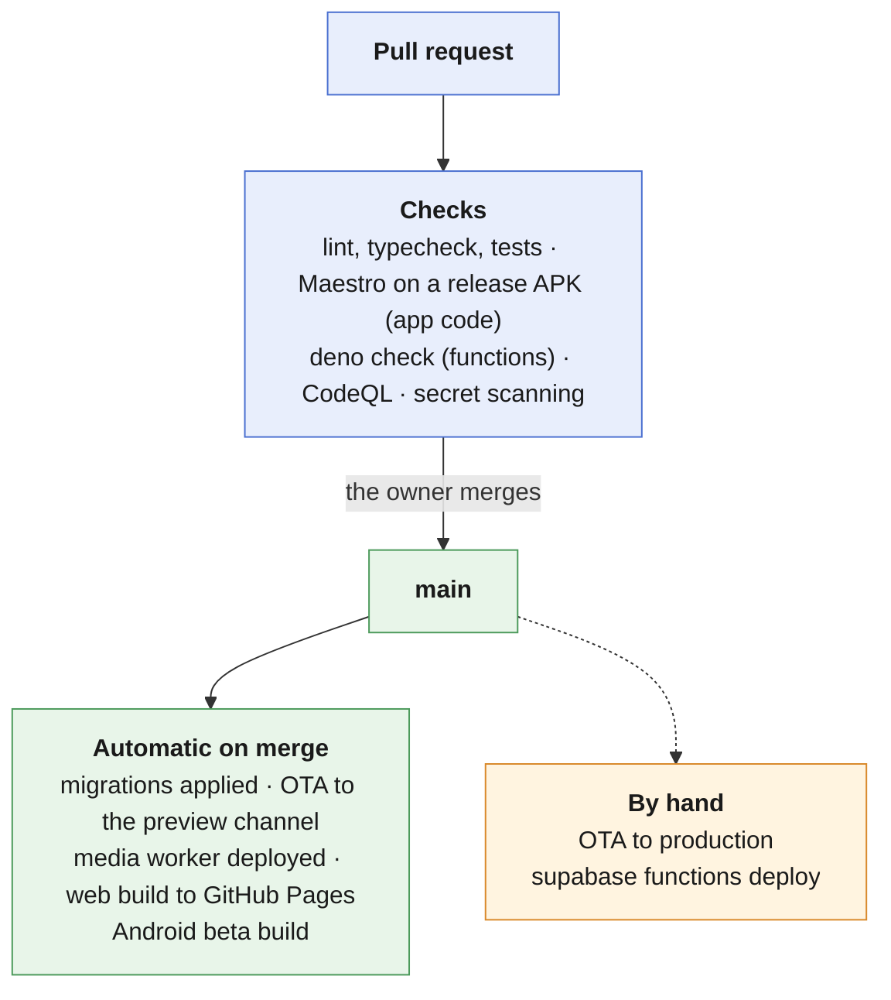

JavaScript ships over the air in minutes; a database migration applies about a minute after merge; native changes
need a store build. Over-the-air updates are keyed to a **fingerprint** of everything native, so an update only
reaches builds it is compatible with. Details in [operations](docs/architecture/06-operations.md).

### Performance characteristics

Measured, not aspirational. The numbers depend on where they are measured from.

| | |
|---|---|
| **Network floor** | About **200 ms** per request from the development machine to Tokyo, even for a call that touches no database; edge functions add about 200 ms. A screen is as fast as its number of *sequential* requests |
| **Inside Postgres** | Typical queries about 1 ms; a trigger-heavy insert a few ms (a direct message with six triggers: 2.6 ms; the whole send 5-10 ms warm) |
| **Cold backend** | The first call on a fresh database connection costs 25-160 ms more, which is why a mean over a few calls can look worse than the typical call |
| **JavaScript bundle** | **9.7 MB** of Hermes bytecode on Android (14.2 MB before the icon set was trimmed to the icons used); every over-the-air update downloads it |
| **Feed** | Ranked in SQL from about 350 bounded candidates; cost scales with daily active users, not registered users |

### Flows in detail

<details open>
<summary><b>Publishing a post:</b> hidden until moderation approves it, and nobody is notified until then</summary>

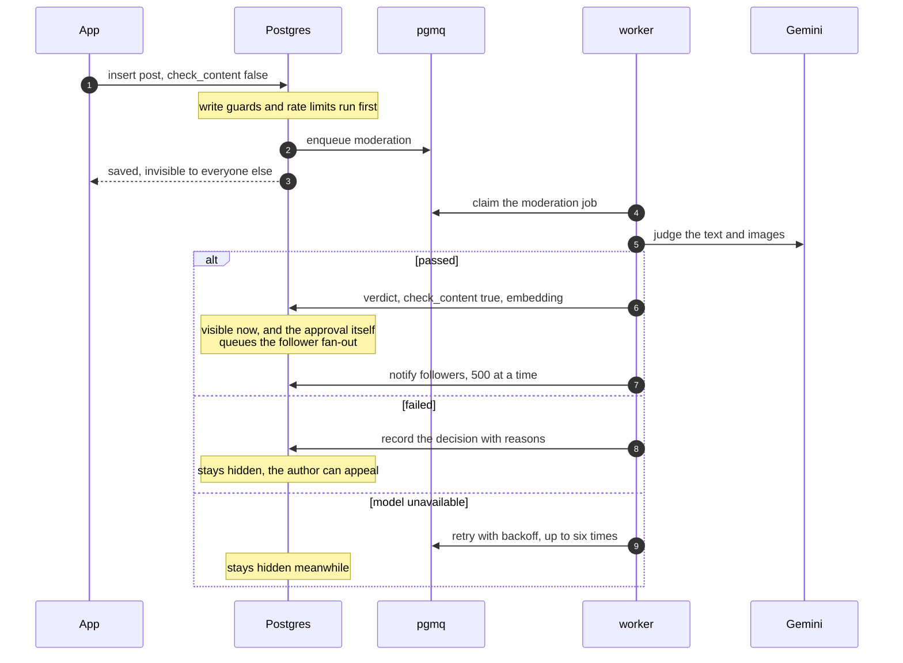

</details>

<details>
<summary><b>Sending a direct message:</b> sealed on the device, ciphertext on the server</summary>

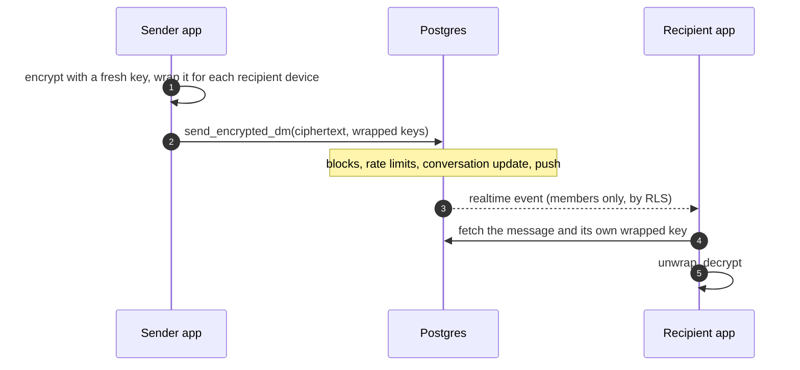

</details>

<details>
<summary><b>A voice command:</b> the device answers first, the model only when it must</summary>

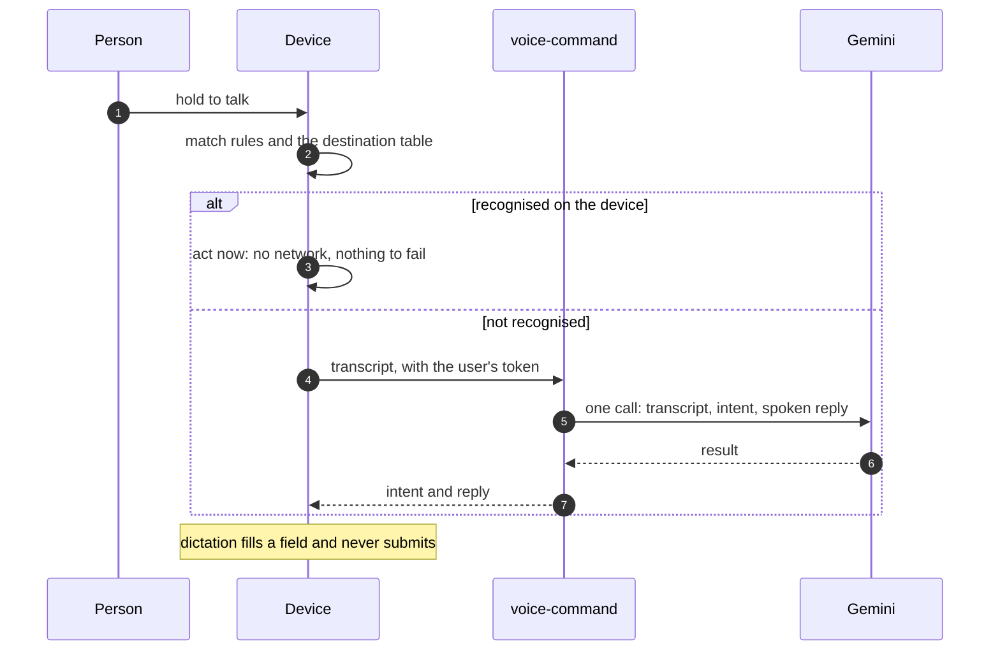

</details>

<details>
<summary><b>Uploading media:</b> straight to object storage, through a worker that decides who may</summary>

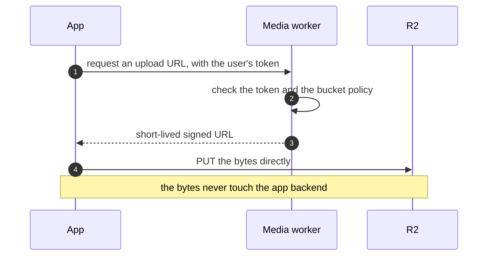

</details>

**[Read the architecture →](docs/architecture/README.md)** covers the other eight flows (sign-in, the feed algorithm,
push, presence, read receipts, private-account follows, account deletion, the daily question), plus the client,
the backend, security, operations, and the decision log.

---

## Production readiness

What it takes to run Echo, and where to look.

| | |
|---|---|
| **Reliability** | Queued side effects with retries and a dead-letter queue; idempotent handlers; fail-closed moderation. See [when things fail](#reliability-when-things-fail) |
| **Observability** | Sentry and PostHog behind a consent banner; a 15-minute external health check (REST, media worker, an edge function, the legal pages, cron health); a 30-minute outcome probe that alerts moderators; `cron_health()` for every job. See [monitoring](docs/runbook/monitoring.md) |
| **Backups and recovery** | A nightly logical dump to R2 that is restore-tested, Supabase's own daily backups, and a recovery bundle that rebuilds an empty database in about a second. The recovery point is the last nightly dump. See [recovery](supabase/recovery/README.md) |
| **Security** | Row-level security on all 95 tables, minimal table privileges, identity from the JWT, authenticated server-to-server calls, pinned edge-function dependencies, secret scanning and CodeQL on every pull request. See [security](docs/architecture/05-security-and-privacy.md) |
| **Privacy** | Private accounts, presence and read receipts enforced in SQL, end-to-end encrypted one-to-one text, a resumable account erasure that reaches every store, no profiling under 18. See [flows](docs/architecture/04-key-flows.md) |
| **Release process** | Every change is a pull request with CI; the owner merges explicitly; JavaScript ships over the air; migrations apply automatically; edge functions deploy by hand; rollback is a republish, a redeploy or a flag. See [operations](docs/architecture/06-operations.md#shipping-a-change) |
| **Compliance** | Terms and Privacy Policy live in code; minimum age 16; built with India's DPDP Act in view. Both documents are drafts pending counsel review. See [compliance](docs/compliance/README.md) |

## Engineering you can verify

Claims are cheap, so each of these points at the thing that enforces it.

| Echo promises | What enforces it | Check it |
|---|---|---|
| **A modified app cannot see or do more than its login allows** | Row-level security on all 95 tables, column grants, and read-only `anon`. Functions that take a user id check the caller | [`supabase/migrations/`](supabase/migrations/) · `npm run probe:flows` |
| **A post is hidden until it passes moderation** | The row is inserted hidden; only a passing verdict makes it visible, and nobody is notified before then. A down or unfunded AI key stops publishing rather than letting content through | [Flow 2](docs/architecture/04-key-flows.md#2-publishing-a-post) |
| **Private messages stay private** | One-to-one text is sealed on the device (XChaCha20-Poly1305, X25519); the server holds ciphertext, and encryption cannot silently fall back | [`lib/e2ee/`](lib/e2ee/) · [design and threat model](docs/design/dm-e2ee.md) |
| **Presence and read receipts expose only what their toggles allow** | One gated function returns an identical answer for "not allowed" and "offline"; no timestamp ever leaves the server | [Flows 6 and 7](docs/architecture/04-key-flows.md#presence) |
| **Deleting your account deletes it** | A stored, resumable erasure that reaches the database, object storage and auth, with a probe asserting no row remains | [Flow 11](docs/architecture/04-key-flows.md#11-deleting-an-account) |
| **It can be rebuilt** | An empty database rebuilds from the repository in about a second; a nightly dump is restore-tested | [`supabase/recovery/`](supabase/recovery/README.md) · [backups](docs/architecture/06-operations.md#backups-and-recovery) |
| **Updates reach people safely** | Over-the-air updates keyed to a native fingerprint; the Android bundle is 9.7 MB | [Operations](docs/architecture/06-operations.md#over-the-air-updates-and-the-fingerprint) |

**Tested at three levels:** 2,437 unit tests, 93 flow probes that run real flows against a local Supabase stack
with throwaway users, and an end-to-end flow on a real release APK for every pull request that changes app
code. Several tests exist to stop a class of mistake: a voice phrase for every screen, a grant for every
selected column, a policy for every upsert, an exact version for every edge-function import. See [testing](docs/testing.md).

### What's built

| | |
|---|---|
| Screens | 93 route files, every one reachable by voice |
| Database | 95 tables, all with row-level security, 220 policies, 223 migrations |
| Backend | 24 edge functions, 10 job queues, 9 scheduled jobs |
| Mini-apps | 22 in the catalog |
| Languages | 26: 13 Indian, 13 global |
| Code | ~115,000 lines of first-party TypeScript |

<sub>Re-derived from the tree and the live database on 2026-10-19. Re-derive before quoting.</sub>

---

## Getting started

| Requirement | Version |
|---|---|
| Node | 20 or newer (CI runs 20) |
| Xcode | For iOS builds |
| JDK | **17**, for Android: 21 and 24 fail the CMake step with a misleading message. With `direnv`, `direnv allow` pins it |
| Supabase CLI | For database work and the flow probes |
| Docker | Only for the local Supabase stack |

```bash
git clone https://github.com/Ak2556/echo-mobile.git
cd echo-mobile
npm ci
cp .env.example .env     # add your Supabase URL and anon key
npm start                # then press i, a or w
```

Without Supabase credentials the app starts with remote features switched off, so you can explore the UI.

**Everyday commands**

```bash
npm run typecheck && npm run lint && npm test   # what CI runs
npm run probe:flows       # 93 outcome checks against a local Supabase stack
npm run audit:backend     # call each production RPC for real
node scripts/gen-icon-shim.mjs   # after adding or removing a Phosphor icon import
npm run i18n:generate     # fill translation gaps from English
```

`android/` and `ios/` are generated by `expo prebuild` and gitignored. **Never edit them**: configure native
behaviour in `app.json`, `app.config.js` and `plugins/`. More in [engineering notes](docs/engineering-notes.md).

## Configuration

Client variables are read at **build time** and are **public in the bundle**: never put a secret in an
`EXPO_PUBLIC_*` variable. Server secrets are set with `supabase secrets set`, never in the app or the repository.

| Variable | Needed for | Notes |
|---|---|---|
| `EXPO_PUBLIC_SUPABASE_URL` | Everything remote | Without it the app runs with remote features off |
| `EXPO_PUBLIC_SUPABASE_ANON_KEY` | Everything remote | Public by design |
| `SUPABASE_PROJECT_REF` | CLI and scripts | Not read by the app |
| `EXPO_PUBLIC_SENTRY_DSN` | Crash reporting | Consent-gated; optional |
| `EXPO_PUBLIC_POSTHOG_KEY`, `EXPO_PUBLIC_POSTHOG_HOST` | Product analytics | Consent-gated; optional |
| `EXPO_PUBLIC_WEB_BASE_URL` | Links, previews, legal pages | Defaults to `https://downloadecho.com` |
| `EXPO_PUBLIC_SUPPORT_EMAIL`, `EXPO_PUBLIC_DSA_EMAIL` | In-app contact addresses | |
| `EXPO_PUBLIC_ANALYTICS_CONSENT_KEY` | Consent storage | Override only if you renamed the key |
| `STATUSPAGE_URL` | A status page link | Optional |

Production builds take these from EAS secrets rather than `.env`. Edge-function secrets (model keys, webhook
secrets, shared secrets) are documented in the header of each function under
[`supabase/functions/`](supabase/functions/) and in the commented section of [`.env.example`](.env.example).

## Troubleshooting

The failures that cost the most time, and where each one comes from.

| Symptom | Cause and fix |
|---|---|
| **Android build fails at the CMake step** | A JDK newer than 17. Use JDK 17 |
| **"Posts are not appearing"** | Moderation fails closed. Check the AI key and quota first, then `cron_health()` and the dead-letter queue. See [flow 2](docs/architecture/04-key-flows.md#2-publishing-a-post) |
| **AI features fail intermittently** | The AI provider's quota. Failures that look like bugs are often quota |
| **A client write fails with a permission error** | A client `upsert` needs an INSERT **and** an UPDATE policy; a new table has no client grants until you add them |
| **A profile query fails with `42501`** | One column the client selects was never granted: that fails the *whole* select. A test catches it |
| **Tests break after adding a native dependency** | Several native modules throw when imported under Node or jsdom. Add a stub in `test/stubs/` |
| **An icon is `undefined` at runtime** | A new Phosphor import is missing from the generated shim. Run `node scripts/gen-icon-shim.mjs` |
| **An update does not reach a device** | The device's native fingerprint differs from the update's runtime version. Check the runtime printed when publishing; builds in the field can have several |
| **A database change passes locally but breaks in production** | Local replay is not faithful to production. Validate the migration against the live schema in a transaction that always rolls back |

## Documentation

| | |
|---|---|
| **[Architecture](docs/architecture/README.md)** | How it is put together, and why |
| **[Engineering notes](docs/engineering-notes.md)** | Repository layout, commands and the gotchas that cost an afternoon |
| **[Testing](docs/testing.md)** | What is tested, and how |
| **[Design docs](docs/README.md)** | End-to-end encryption, presence and read receipts |
| **[Runbooks](docs/runbook/)** | Monitoring, the encryption rollout, rebuilding the database |
| **[Legal and compliance](docs/compliance/README.md)** | Terms, privacy policy, age policy |

## Status and roadmap

Echo is in a polish-and-launch phase: no new features until it is in the stores.

| Horizon | Work |
|---|---|
| **Now** | Polish, store submission, India launch |
| **Next** | Subscriptions once the free tier demonstrably retains; first-party advertising for local and regional brands; more mini-apps in the categories people already return for |
| **Then** | Deeper OS integration (App Intents and Shortcuts so Siri can drive the intent vocabulary, widgets, a share target), and the 13 global languages already built into the product |

### Known limitations

Stated plainly, because each is easy to assume the other way.

| | |
|---|---|
| **End-to-end encryption is one-to-one text only** | Photos, voice, groups and older messages are not encrypted, there is no forward secrecy, and the server still sees who talks to whom. What may be claimed publicly is in the [rollout runbook](docs/runbook/e2ee-rollout.md) |
| **Video is not visually moderated** | Text and still images pass an AI gate; a still-image model cannot read an mp4 |
| **Subscriptions are not wired** | The server side exists; the client ships no purchase SDK and everyone is on the free plan |
| **Translations are being regenerated** | The interface localisation works, but many non-English strings came from a faulty generator. Hindi has been hand-corrected and awaits native review |
| **Some features are built but switched off** | Salons, office hours, stories, quests, badges, Year in Echo and live audio are behind remote flags that are off in production |
| **Presence and read receipts need a two-device check** | Covered by probes and unit tests; two real phones confirming the dot, the phrase and the toggle are still owed |
| **There is no staging database** | Production is the only hosted database, which is why migrations are validated against the live schema before they merge |

## Contributing, security, support

- **Contributing.** Issues and pull requests are welcome. Read [CONTRIBUTING.md](CONTRIBUTING.md) first: most
  surprises are listed there. CI runs lint, typecheck and the tests on every pull request, and the
  [pull request template](.github/PULL_REQUEST_TEMPLATE.md) asks for an honest "Unverified" section.
  Please follow the [code of conduct](CODE_OF_CONDUCT.md).
- **Security.** Report a vulnerability privately, not in an issue: see [SECURITY.md](SECURITY.md).
- **Support.** [downloadecho.com](https://downloadecho.com), or `support@downloadecho.com`.
- **Legal.** The Terms and Privacy Policy live in code so the app and any web mirror cannot drift apart. Both
  are **drafts pending counsel review**. Minimum age 16; under 18, no advertising and no behavioural profiling,
  enforced in Postgres. Details in [docs/compliance](docs/compliance/README.md).

## Licence and acknowledgements

MIT. See [`LICENSE`](LICENSE). Copyright attribution is provisional pending an operating entity.

Echo stands on [Expo](https://expo.dev), [React Native](https://reactnative.dev), [Supabase](https://supabase.com),
[Cloudflare](https://www.cloudflare.com), [TanStack Query](https://tanstack.com/query), [Hono](https://hono.dev),
[Phosphor Icons](https://phosphoricons.com) and many other open-source projects. [`NOTICE`](NOTICE) and
[`sbom.json`](sbom.json) record third-party attribution and licence elections (`npm run legal:sbom`).

---

<div align="center">
<sub>Built by <a href="https://github.com/Ak2556">Akash Thakur</a> · <a href="https://downloadecho.com">downloadecho.com</a></sub>
</div>
