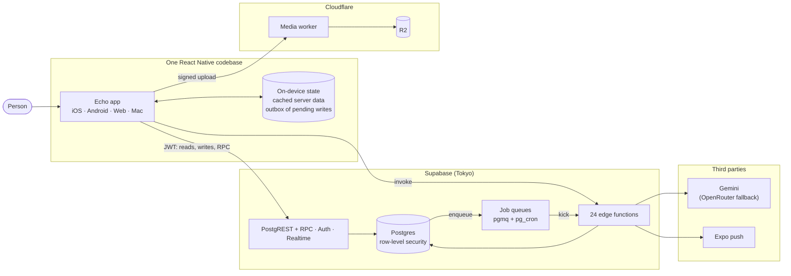

<div align="center">


# Echo

### Speak. Echo does the rest.

**A voice-first social network for India.** One recording becomes a post, a search, or an action, in the
language you speak. 26 languages, one codebase for iOS, Android, web and Mac, and one-to-one text messages
only the two of you can read.

<p>
<a href="https://github.com/Ak2556/echo-mobile/actions/workflows/ci.yml"></a>


<a href="LICENSE"></a>
</p>

**[Download](https://downloadecho.com)** · **[Architecture](docs/architecture/README.md)** · **[Documentation](docs/README.md)** · **[Contributing](CONTRIBUTING.md)** · **[Security](SECURITY.md)**

<br />

<table>
<tr>
<td align="center"></td>
<td align="center"></td>
<td align="center"></td>
<td align="center"></td>
<td align="center"></td>
</tr>
<tr>
<td align="center"><sub><b>One build.</b><br />English, हिन्दी, العربية</sub></td>
<td align="center"><sub>Home</sub></td>
<td align="center"><sub>The Daily Question</sub></td>
<td align="center"><sub>The assistant</sub></td>
<td align="center"><sub>Everyday tools</sub></td>
</tr>
</table>

<br />

<sub>Private beta with 20 testers across ten age groups. Store submission next.</sub>

</div>

---

## Why Echo exists

Writing a full thought in Devanagari or Tamil on a phone is slow enough that most people simply don't. The
thought gets shortened, or never posted. And apps that *do* translate usually translate the content while
leaving an English interface around it, so the product never feels made for you.

Echo starts from the other end.

<table>
<tr>
<td width="33%" valign="top">

### Speak, and it acts

One recording becomes a transcript, an intent and a spoken reply in a **single model call**. Echo posts it,
searches it, opens the tool you asked for, or dictates into the field you are looking at.

19 intents. Every screen is reachable by voice, **enforced by a test**. Navigation never calls the model.

</td>
<td width="33%" valign="top">

### The interface is localised, not just the content

Greeting, tabs, prompts and layout direction all follow the reader. The same build renders left to right
in Hindi and right to left in Arabic.

26 languages: 13 Indian, 13 global.

</td>
<td width="33%" valign="top">

### A reason to return that isn't the scroll

One Daily Question, the same for everyone, that **closes**: you answer, you read what the network said,
you're done until tomorrow.

Plus a shelf of everyday tools for the days you have nothing to post.

</td>
</tr>
</table>

## What it does

| | |
|---|---|
| **Social** | Posts with image and video, comments, reactions, reposts, follows, bookmarks, blocks and mutes. **Private accounts** where following needs approval |
| **Messaging** | One-to-one and group chats. One-to-one text is **end-to-end encrypted**. Read receipts and presence that do what their toggles say |
| **Voice** | Hold to talk. Dictation fills a field and **never submits**, so a mis-transcription cannot publish or reply on its own |
| **AI** | An assistant with tool-calling, runtime translation of the interface, and recommendations from what you like |
| **Mini-apps** | Habits, tasks, notes, planner, expenses, fitness, pomodoro and more, synced across devices |
| **Trust and safety** | Text *and* uploaded images are judged before anything reaches the feed; reports, a moderator role, statements of reasons and a six-month appeals window |

## How it works



Three ideas explain most of the design:

1. **The database is the rulebook.** Who may read or write what, how often, and what follows are enforced in
   Postgres (row-level security, triggers, functions), not in the app. A modified client can reach exactly
   what its login allows.
2. **Side effects are queued, not chained.** A post, a message or a purchase writes a row and enqueues a job;
   a worker does the slow part, retries it, and dead-letters it if it never succeeds.
3. **The device works without the network.** Writes that must survive go through an outbox, and server data
   is cached for seven days.

**[Read the architecture →](docs/architecture/README.md)** Seven short pages: components and trust boundaries,
the client, the backend, twelve key flows as sequence diagrams, security, operations, and a log of every
major decision and what it cost.

## Engineering you can verify

Claims are cheap, so each of these points at the thing that enforces it.

| Echo promises | What enforces it | Check it |
|---|---|---|
| **A modified app cannot see or do more than its login allows** | Row-level security on all 95 tables, column grants, and read-only `anon`. Functions that take a user id check the caller | [`supabase/migrations/`](supabase/migrations/) · `npm run probe:flows` |
| **A post is hidden until it passes moderation** | The row is inserted hidden; only a passing verdict makes it visible. A down or unfunded AI key stops publishing rather than letting content through | [Flow 2](docs/architecture/04-key-flows.md#2-publishing-a-post) |
| **Private messages stay private** | One-to-one text is sealed on the device (XChaCha20-Poly1305, X25519); the server holds ciphertext, and encryption cannot silently fall back | [`lib/e2ee/`](lib/e2ee/) · [design and threat model](docs/design/dm-e2ee.md) |
| **Presence and read receipts expose only what their toggles allow** | One gated function returns an identical answer for "not allowed" and "offline"; no timestamp ever leaves the server | [Flows 6 and 7](docs/architecture/04-key-flows.md#presence) |
| **Deleting your account deletes it** | A stored, resumable erasure that reaches the database, object storage and auth, with a probe asserting no row remains | [Flow 11](docs/architecture/04-key-flows.md#11-deleting-an-account) |
| **It can be rebuilt** | An empty database rebuilds from the repository in about a second; a nightly dump is restore-tested | [`supabase/recovery/`](supabase/recovery/README.md) · [backups](docs/architecture/06-operations.md#backups-and-recovery) |
| **Updates reach people safely** | Over-the-air updates keyed to a native fingerprint; the Android bundle is 9.7 MB | [Operations](docs/architecture/06-operations.md#over-the-air-updates-and-the-fingerprint) |

**Tested at three levels:** 2,413 unit tests, 87 flow probes that run real flows against a local Supabase stack
with throwaway users, and an end-to-end flow on a real release APK for every pull request that changes app
code. Several tests exist to stop a class of mistake: a voice phrase for every screen, a grant for every
selected column, a policy for every upsert. See [testing](docs/testing.md).

### What's built

| | |
|---|---|
| Screens | 93 route files, every one reachable by voice |
| Database | 95 tables, all with row-level security, 220 policies, 223 migrations |
| Backend | 24 edge functions, 10 job queues, 9 scheduled jobs |
| Mini-apps | 22 in the catalog |
| Languages | 26: 13 Indian, 13 global |
| Code | ~115,000 lines of first-party TypeScript |

<sub>Re-derived from the tree and the live database on 2026-10-19. Re-derive before quoting.</sub>

## Getting started

**Prerequisites:** Node 20+ and the Expo tooling. iOS builds need Xcode. Android needs **JDK 17**, not 21 or 24
(the CMake step fails with a misleading message); if you use `direnv`, `direnv allow` pins it.

```bash
git clone https://github.com/Ak2556/echo-mobile.git
cd echo-mobile
npm ci
cp .env.example .env     # add your Supabase URL and anon key
npm start                # then press i, a or w
```

Without Supabase credentials the app starts with remote features switched off, so you can explore the UI.
For everyday commands, the repository layout and the traps worth knowing about, see
[engineering notes](docs/engineering-notes.md).

## Documentation

| | |
|---|---|
| **[Architecture](docs/architecture/README.md)** | How it is put together, and why |
| **[Engineering notes](docs/engineering-notes.md)** | Repository layout, commands and the gotchas that cost an afternoon |
| **[Testing](docs/testing.md)** | What is tested, and how |
| **[Design docs](docs/README.md)** | End-to-end encryption, presence and read receipts |
| **[Runbooks](docs/runbook/)** | Monitoring, the encryption rollout, rebuilding the database |
| **[Legal and compliance](docs/compliance/README.md)** | Terms, privacy policy, age policy |

## Status and roadmap

Echo is in a polish-and-launch phase: no new features until it is in the stores.

| Horizon | Work |
|---|---|
| **Now** | Polish, store submission, India launch |
| **Next** | Subscriptions once the free tier demonstrably retains; first-party advertising for local and regional brands; more mini-apps in the categories people already return for |
| **Then** | Deeper OS integration (App Intents and Shortcuts so Siri can drive the intent vocabulary, widgets, a share target), and the 13 global languages already built into the product |

### Known limitations

Stated plainly, because each is easy to assume the other way.

| | |
|---|---|
| **End-to-end encryption is one-to-one text only** | Photos, voice, groups and older messages are not encrypted, there is no forward secrecy, and the server still sees who talks to whom. What may be claimed publicly is in the [rollout runbook](docs/runbook/e2ee-rollout.md) |
| **Video is not visually moderated** | Text and still images pass an AI gate; a still-image model cannot read an mp4 |
| **Subscriptions are not wired** | The server side exists; the client ships no purchase SDK and everyone is on the free plan |
| **Translations are being regenerated** | The interface localisation works, but many non-English strings came from a faulty generator. Hindi has been hand-corrected and awaits native review |
| **Some features are built but switched off** | Salons, office hours, stories, quests, badges, Year in Echo and live audio are behind remote flags that are off in production |
| **Presence and read receipts need a two-device check** | Covered by probes and unit tests; two real phones confirming the dot, the phrase and the toggle are still owed |

## Contributing, security, legal

- **Contributing.** Issues and pull requests are welcome. Read [CONTRIBUTING.md](CONTRIBUTING.md) first: most
  surprises are listed there. CI runs lint, typecheck and the tests on every pull request.
- **Security.** Please report a vulnerability privately, not in an issue: see [SECURITY.md](SECURITY.md).
- **Legal.** The Terms and Privacy Policy live in code so the app and any web mirror cannot drift apart. Both
  are **drafts pending counsel review**. Minimum age 16; under 18, no advertising and no behavioural profiling,
  enforced in Postgres. Details in [docs/compliance](docs/compliance/README.md).
- **Licence.** MIT. See [`LICENSE`](LICENSE). Copyright attribution is provisional pending an operating entity.

---

<div align="center">
<sub>Built by <a href="https://github.com/Ak2556">Akash Thakur</a> · <a href="https://downloadecho.com">downloadecho.com</a></sub>
</div>
