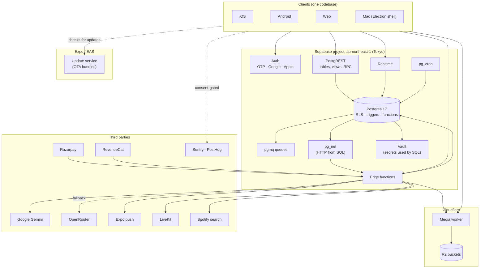
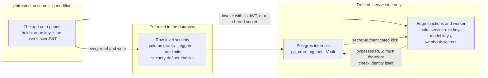

# 01 · System overview

[← Architecture index](README.md) · Next: [02 · The client app](02-client-app.md)

## What the product asks of the system

The product shapes the architecture more than any technology choice does:

| Product fact | What it forces |
|---|---|
| **Voice is the main input**, in English and Hindi at launch | One recording must become a transcript, an intent and a reply in a single model round trip, and common commands must resolve on the device with no network at all |
| **The interface itself is localised**, including right-to-left | Layout and strings follow the reader, not only the content |
| **Built for India first**, on phones with uneven connectivity | Writes survive a dead connection; messages work offline; media goes straight to object storage |
| **It is a social network with private messages** | Privacy rules must hold even against a modified client, so they live in the database |
| **Posts are public the moment they are published** | Moderation must fail closed: a post is invisible until a classifier passes it |
| **A free-tier AI budget** | Every model call is metered, time-limited and has a fallback provider |

## Components

| Component | Technology | Runs on | Owns |
|---|---|---|---|
| **App** | React Native 0.81, Expo SDK 54, expo-router | iOS, Android, web, Electron | Screens, on-device state, the outbox, on-device voice intents, end-to-end encryption |
| **Auth** | Supabase Auth (GoTrue) | Supabase | Email and phone one-time codes, Google, Apple; PKCE; the JWT every request carries |
| **API** | PostgREST over Postgres | Supabase | Reads and writes on tables and views, and RPCs, all under row-level security |
| **Database** | Postgres with `pgvector`, `pg_trgm`, `pg_cron`, `pg_net`, `pgmq`, `supabase_vault` | Supabase | The data, the rules, the triggers, the queues and the schedules |
| **Realtime** | Supabase Realtime | Supabase | Pushes row changes for `notifications`, `direct_messages` and `calls` to subscribed clients |
| **Edge functions** | Deno | Supabase | Everything that needs a secret, a model, or an outside API: AI chat, voice, moderation, push delivery, webhooks, the job worker |
| **Media worker** | Hono on Cloudflare Workers, `aws4fetch` | Cloudflare | Mints short-lived signed upload URLs, serves media with the right cache policy, gates direct-message media, purges objects |
| **Object storage** | Cloudflare R2 | Cloudflare | Uploaded media: avatars, post media, direct-message media, mini-app media, marketplace photos, lecture video |
| **Updates** | EAS Update | Expo | JavaScript bundles delivered over the air to installed apps |
| **Monitoring** | Sentry, PostHog, GitHub Actions | various | Crash reports and analytics (both consent-gated); synthetic health checks every 15 minutes |

## Where data physically lives

| Data | Where | Why it matters |
|---|---|---|
| Postgres and Auth | Supabase `ap-northeast-1` (Tokyo) | Every request crosses to Tokyo. See [performance](#performance-characteristics) below |
| Uploaded media | Cloudflare R2 | Never transits the app backend: the client uploads straight to R2 |
| Nightly database dumps | R2 | Plus Supabase's own daily backups; see [operations](06-operations.md#backups-and-recovery) |
| Model inference | Google (Gemini), OpenRouter as fallback, United States | Prompts and transcripts leave the region |
| Crash reports and analytics | Sentry and PostHog, United States | Consent-gated |

The privacy policy ([`constants/legal/privacyPolicy.ts`](../../constants/legal/privacyPolicy.ts)) is
written against this table; change one and you must revisit the other.

## Trust boundaries

Who is trusted with what is the most important fact about the system, so it is worth drawing:

- The client holds only the **anon key** and the signed-in user's **JWT**. The service-role key is
  not in any bundle (this was checked in the release bundle, the OTA bundle and the web export).
- Everything a client does goes through RLS, so a compromised client reaches what its JWT allows.
- Code that *does* bypass RLS (edge functions using the service role, `security definer` SQL
  functions) is the dangerous part of the system, so it is small, and each such function must check
  who is calling. See [05 · Security and privacy](05-security-and-privacy.md).
- Eight edge functions skip the gateway's JWT check because their caller is not a signed-in user.
  Six prove the caller themselves: the worker, the daily-question and personalised-push jobs (a
  constant-time shared-secret comparison against a value only the database holds), the two payment
  webhooks (a signature check), and the voice endpoint (a token lookup). Two are **deliberately
  public**: the link-preview endpoint `og-redirect` (it reads with the anon key, so row-level
  security still applies) and `learn-guest-booking`, which lets someone without an account request a
  tutoring slot. The public two are safe by being narrow, not by authenticating.

## Technology choices, briefly

The full reasoning, including what each choice cost, is in the [decision log](07-decision-log.md).

| Choice | In one line |
|---|---|
| React Native + Expo, one codebase | Four platforms from one team; native config is generated, never hand-edited |
| Supabase, not a custom API | Postgres plus row-level security replaces a service layer; the old FastAPI service was removed |
| Rules in SQL | A modified client cannot get around them |
| Queues inside Postgres (`pgmq`) | A job is enqueued in the same transaction as the row that needs it, so neither can be lost without the other |
| Cloudflare R2 behind a Worker | Cheap object storage; the Worker is the single place that decides who may upload or read |
| Gemini direct, OpenRouter as fallback | Cheaper and faster on the primary path, with a second provider so quota or an outage does not stop the app |
| Device-held keys for DMs | The server cannot read one-to-one text messages, at the cost of no forward secrecy and no server-side search |

## Performance characteristics

These are measured, not aspirational, and they set the real design constraint:

- **The floor is the network, not the database.** From the development machine, every Supabase
  endpoint, even `/auth/v1/health`, which touches no database, takes about **200 ms** on a warm
  connection, because the project is in Tokyo. An edge function adds about 200 ms more. A typical
  query inside Postgres takes around 1 ms and a trigger-heavy insert a few milliseconds.
- **So a screen is as fast as its number of sequential requests.** Reduce round trips, not query
  time. This is why feeds are cursor-paginated in one call, why a post queues one fan-out job rather
  than writing a notification per follower, and why profile screens were reduced from five
  sequential requests to two.
- **The JavaScript bundle is 9.7 MB of Hermes bytecode on Android** (it was 14.2 MB before the icon
  set was trimmed to the icons actually used). Every over-the-air update downloads it.
- **Everything that can be answered on the device is.** Navigation by voice, theme, language and
  most settings resolve locally and cost nothing.

Re-measure before quoting any of these: they depend on where the measuring machine is.

[← Architecture index](README.md) · Next: [02 · The client app](02-client-app.md)
