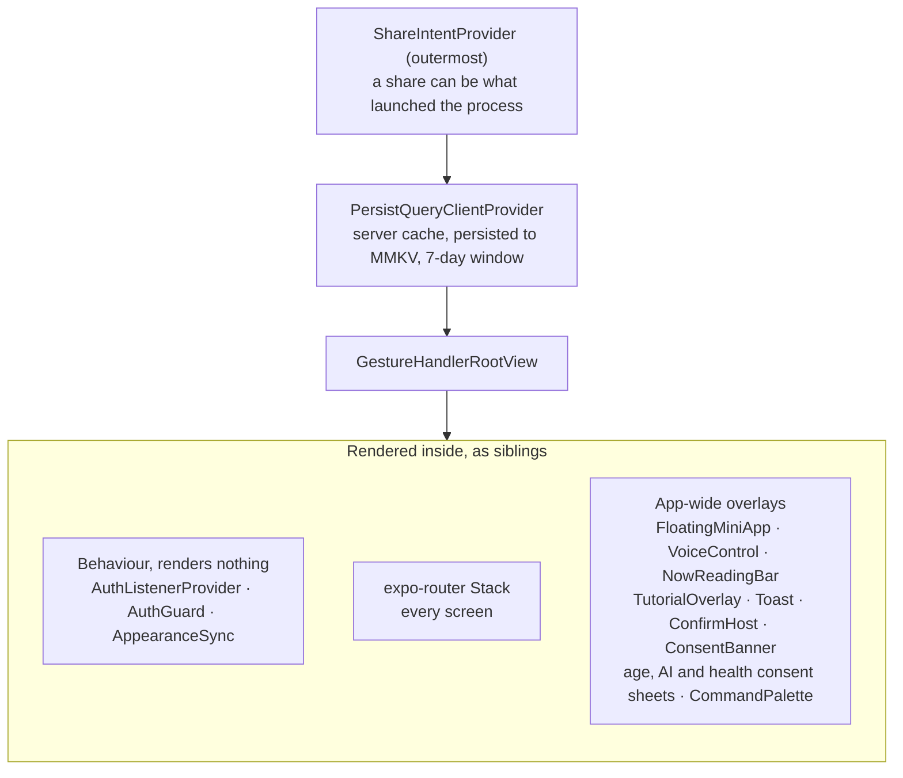
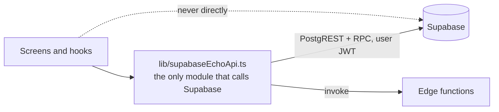
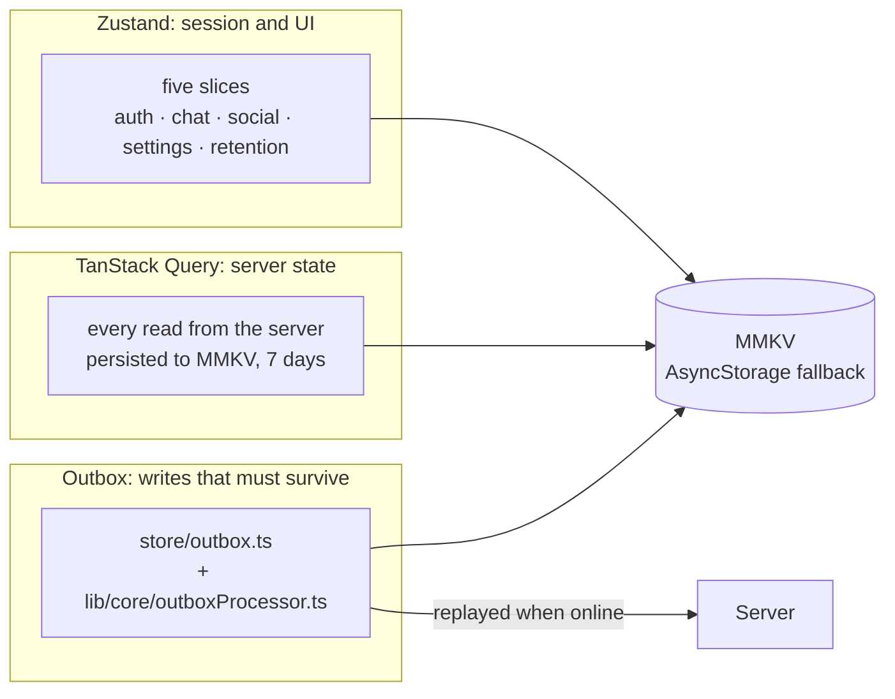
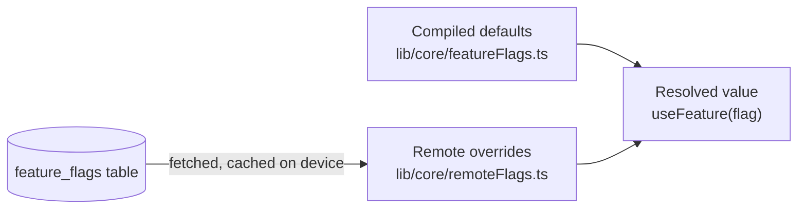
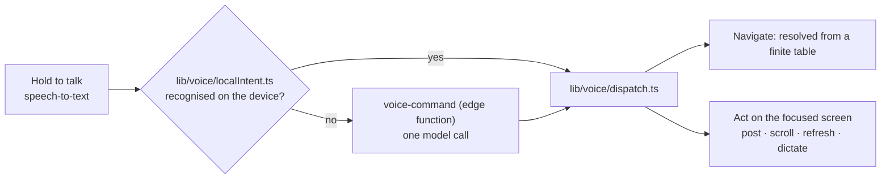

# 02 · The client app

[← Overview](01-system-overview.md) · [Index](README.md) · Next: [03 · Backend and data](03-backend-and-data.md)

One React Native codebase ships to iOS, Android, web and a Mac desktop shell (Electron). This page
explains how it is organised and why. For the product behaviour see the [README](../../README.md).

## Layout of the code

```text
app/             screens: expo-router, file-based routing
components/      UI by area: feed/ chat/ voice/ ranks/ mini-apps/ ui/ common/ ...
hooks/           React Query hooks (feed, ads, ranks; queries/ for DMs, follows, profile ...)
lib/             logic by area; supabaseEchoApi.ts is the single gateway to Supabase
  ai/ auth/ core/ e2ee/ feed/ i18n/ media/ mini-apps/ notifications/ privacy/
  retention/ routing/ social/ ui/ voice/ ...
store/           Zustand slices and the outbox
plugins/         Expo config plugins: every native change lives here
```

`@/*` maps to the repository root. Imports inside `app/` are relative.

## How the app starts

`app/_layout.tsx` is the root. It composes the whole runtime in one place:



`AuthListenerProvider` is not a wrapper: it renders nothing and reacts to sign-in changes (it
navigates), which is why it must wait for the navigator to exist.

Two rules come from bugs that actually happened:

- **Cold-start routing waits for the navigator.** Several past bugs came from navigating before
  `useRootNavigationState` reported the navigator mounted.
- **The first paint must not wait for the network.** Server state is read from the persisted cache
  first, so the last-seen feed, profile and conversation list open immediately.

## Navigation

Routing is file-based. The bottom bar is built from the tab routes in `app/(tabs)/`: **Home,
Explore, Watch, Chat, Tools (the mini-app shelf), You**, plus a **notifications** route that has no
tab (it opens from the bell in the header). The bar currently shows five of them (Home, Explore, Chat, Tools, You). Everything
else (a thread, a profile, settings, the composer) is pushed on the root stack above the tabs.

Notification taps from a push and from the in-app inbox go through one resolver,
[`lib/notifications/tapTarget.ts`](../../lib/notifications/tapTarget.ts), which waits for both the
navigator and the sign-in to be ready before routing.

## Data access: one gateway



Screens never import the Supabase client. Everything goes through `lib/supabaseEchoApi.ts`. That
gives one place to see every query the app can make, one place to handle errors, and one place to
change when the schema does. Because **row-level security is the real enforcement**, the client
code is deliberately thin: it asks, and the database decides.

One consequence worth knowing: a client `upsert` is an `INSERT ... ON CONFLICT`, so it needs an
UPDATE policy as well as an INSERT policy to succeed under RLS. A test
([`test/upsertPolicies.test.ts`](../../test/upsertPolicies.test.ts)) fails the build if any client
upsert has no policy to land on.

## State: two layers and an outbox



| Layer | Holds | Persistence |
|---|---|---|
| **Zustand** (`store/useAppStore.ts`, five slices) | Session, settings, UI state, the retention loop | MMKV through `store/persist.ts`, with an AsyncStorage fallback. On the fallback path the store hydrates *after* creation, so an early read can see defaults |
| **TanStack Query** | All server data | Persisted to MMKV with a seven-day window |
| **Outbox** | Writes made offline | Persisted; replayed in order with backoff |

**The outbox.** Likes, bookmarks, reposts, follows, new echoes (including their image and video
uploads), comments, comment likes, reactions and daily answers are queued on the device and replayed
when the connection returns. Every replay handler must be **safe to run twice**, because a drain can
run twice (the app is foregrounded, the network flaps, or a request succeeds but its response is
lost). Likes, bookmarks, reposts, follows, reactions and comment likes *set* a state rather than
flip one, and the database has unique keys; a daily answer is an upsert keyed on user and question;
a publish carries a client-supplied id; a comment is not naturally idempotent and has its own
handling. A write that has failed for too long is expired rather than retried forever.

**Direct messages are not in the outbox.** They are server state like any other: the query layer
caches each thread, and an incoming realtime event is merged into the cached pages **in place**
([`lib/social/messageCache.ts`](../../lib/social/messageCache.ts)) rather than refetching every page.
The sender sees an optimistic "pending" bubble that is replaced, in the same position, by the real
message when the server confirms.

> A WatermelonDB (SQLite) layer is still imported by the root layout, which constructs the database
> at startup, and it is reset on sign-out. Nothing reads or writes it: the sync that fed it was
> removed deliberately (commit `49ee25ec`, "remove the local sync that polled into a store nothing
> read"). It is a candidate for removal, which would also trim startup work and bundle size.

## Feature flags and the kill switch



The compiled map is the **default**, and the remote table is a layer on top. That ordering is the
safety property: an unreachable database, a corrupt cache, or a flag with no row all resolve to
what shipped. Treating the table as the source of truth instead would turn one bad network into an
app with no features. Reads are synchronous (a menu is built from flags during render) and the cache
is hydrated from the same synchronous storage as the store, so a cold start already has the last
known values.

In production today the daily question, the mini-apps and end-to-end-encrypted DMs are on. Salons,
office hours, stories, quests, badges, Year in Echo and live audio are built but switched off.

## Internationalisation

- `lib/i18n/i18n.ts` is the source: `BASE_TRANSLATIONS` (English) plus a map per language, with
  `ttx(text)` for strings written inline in code. 26 languages in the code (13 Indian, 13 global), of which only English and Hindi are offered at launch (`LAUNCH_LANGUAGE_CODES`); the rest wait for a re-translation run.
- `npm run i18n:generate` machine-translates the gaps into `lib/i18n/i18nGenerated.ts`, the only
  generated file. Hand-written strings win at runtime. Hindi has a hand-written set
  (`i18nPhrasesHi.ts`) that is marked for native-speaker review.
- **Layout is part of localisation.** The same build renders left-to-right in Hindi and
  right-to-left in Arabic, so a layout that assumes direction is a bug.
- Many non-English entries are known to be corrupt from an earlier generator; a re-translation run
  is still owed (see the README's known limitations).

## Voice

The product's central path. A hold-to-talk recording becomes a transcript, an intent and a spoken
reply in **one** model call, and common commands never reach the model at all.



- There are **19 intents** (`lib/voice/types.ts`).
- **Navigation never calls the model**: the destinations are a finite table
  (`lib/voice/destinations.ts`) resolved on the device, so it is instant and free.
- **Handlers belong to the focused screen, never merely a mounted one.** When a screen blurs, the
  dispatcher sees nothing instead of falling back to a stale action, because a stale action is worse
  than none when the user cannot tell what it hit.
- **Dictation fills a field and never submits.** A mis-transcription must not be able to publish a
  post or send a reply on its own.
- Coverage is enforced: a test fails if a screen has no voice phrase or a multiline field has no
  dictation handler.
- Extend `localIntent.ts` before adding a server round trip. A short ordinary sentence that fires an
  action by mistake is the failure mode to watch.

## End-to-end encryption (client side)

One-to-one text is sealed on the device before it is sent; the server only ever stores ciphertext.
The code is in `lib/e2ee/` and is deliberately split so the cryptography can be tested under Node
with no React Native in sight.

- `crypto.ts`: the pure core. Per message, a fresh 32-byte key encrypts the body with
  XChaCha20-Poly1305; an ephemeral X25519 key pair wraps that key to each recipient device
  (HKDF-SHA256, then XChaCha20-Poly1305). Both encryptions carry their context (message,
  conversation, sender, device) as associated data, so the server cannot move a body or a wrapped
  key anywhere else without authentication failing. A failure always throws; nothing returns
  garbage or a partial result.
- `deviceKeys.ts`: each device holds its own key pair. The key survives sign-out.
- `messages.ts` and `sendTargets.ts`: sealing a message, and choosing which of the recipient's
  devices to wrap the key for.
- `cache.ts`: decrypted messages seen this session, **in memory only** and cleared on sign-out. It
  exists because editing (reuse the key), forwarding (re-seal for someone else) and reporting
  (disclose to moderators) all need the plaintext after the render pass.
- `report.ts`: what a participant's device discloses when they report a sealed message, only on an
  explicit report: the message, its key (so a moderator can check the text against the stored
  ciphertext) and up to five earlier messages for context. The server cannot read the chat by itself.

The full threat model, including what this does **not** protect against, is in
[`docs/design/dm-e2ee.md`](../design/dm-e2ee.md).

## Theming and shared components

- `useTheme()` returns colours, font sizes, radii and an `animation()` helper that returns
  `undefined` when reduced motion is on. **No colour is hard-coded.**
- Shared primitives live in `components/ui/` (`Button`, `Avatar`, `Skeleton`, `Toast`, ...) and
  `components/common/` (`BottomSheet`, `ConfirmSheet`, `LoadingState`, `EmptyState`, `ErrorState`).
  Icons come from one library (Phosphor) through a size scale.
- Source-reading tests in `test/` keep the system uniform (for example, that nothing hard-codes a
  colour and that user-visible text goes through the i18n layer).

## Glass surfaces

The interface is glass: translucent panels over the content, with a performance budget. Four looks, chosen per
surface at render time:

| Look | What it is | Chosen when |
|---|---|---|
| **Native Liquid Glass** | iOS 26's `UIGlassEffect` through `expo-glass-effect`; adjacent panes merge | The tier is not solid, iOS 26 supports it and the binary includes the module |
| **Shader** | Blur plus a Skia shader that draws the refractive rim (refraction, dispersion, a contact line) | A high-end device, a non-`hot` surface, motion allowed, and Skia present |
| **Blur** | `GlassPanel`: blur, tinted fill, bevel and highlight | Everything else that can afford it |
| **Solid** | An opaque surface | A non-glass theme, data saver, OS Reduce Transparency, or a low-end device |

The decision lives in `lib/ui/performance.ts` (`resolvePerformanceProfile`, which applies the accessibility and
device limits) and `components/ui/liquidGlassTier.ts` (`resolveSurface`, which applies a per-call-site ceiling and
checks that Skia is really in this binary). A shader cannot sample the React Native views behind it, so it cannot
truly refract them; the blur does the obscuring. Native glass is the only tier with real refraction. Both native
modules are required lazily inside a `try`, because JavaScript updates reach binaries that predate the dependency and
a bare import there would crash at launch rather than lose an effect.

## Performance rules

Performance is a stated priority, ahead of visual effects.

- **No live blur over scrolling content.** A live blur behind the header and tab bar was measured at
  about 6 ms of GPU per scrolled frame. Use a translucent solid tint.
- **Judge frame cost on a release build,** with `dumpsys gfxinfo` frame percentiles, and always run
  a control app alongside: an emulator's absolute numbers say little about the app.
- **Bundle size matters because updates download it.** The package barrel for the icon library put
  all 1,512 icons in the bundle; Metro now resolves it to a generated file with the few hundred the
  app imports ([`lib/core/phosphorShim.js`](../../lib/core/phosphorShim.js), regenerated by
  `node scripts/gen-icon-shim.mjs`, enforced by a test). That cut the Android Hermes bundle from
  14.15 MB to 9.73 MB.
- **The network dominates.** See [overview](01-system-overview.md#performance-characteristics): count
  sequential requests, not queries.

## Testing

| Kind | Where | What it covers |
|---|---|---|
| **Unit** (Vitest, `logic` project) | `*.test.ts` beside the code, plus `test/` | Pure logic: scoring, outbox policy, E2EE, presence, the voice dispatcher |
| **Component** (Vitest, `ui` project, jsdom) | `*.test.tsx` | Screens and components, with `react-native` aliased to `react-native-web` |
| **Source guards** | `test/` | Promises the product makes: a voice phrase per screen, a grant per selected column, a policy per upsert, no hard-coded colours |
| **End to end** (Maestro) | `e2e/` | A cold-launch flow on a real release APK, on every pull request |
| **Flow probes** | `scripts/probe-flows.mjs` | Real flows against a local Supabase stack: who may see or do what |

A new native dependency imported at module load will break unrelated unit tests until it has a stub
in `test/stubs/`, because several native modules throw when imported under Node or jsdom.

[← Overview](01-system-overview.md) · [Index](README.md) · Next: [03 · Backend and data](03-backend-and-data.md)
