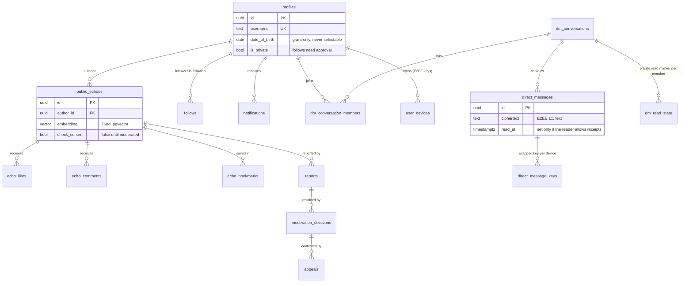
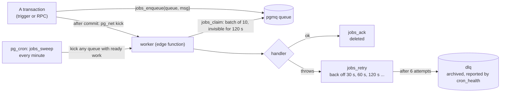

# 03 · Backend and data

[← The client app](02-client-app.md) · [Index](README.md) · Next: [04 · Key flows](04-key-flows.md)

The backend is one Supabase project (Postgres 17, Auth, Realtime, Storage, Deno edge functions)
plus a Cloudflare Worker for media. Almost all the logic that matters lives **in the database**, and
this page is mostly about that.

## Design stance

| Principle | In practice |
|---|---|
| **The database is the rulebook** | Access, limits and consequences are row-level security, column grants, triggers and functions. The client asks; Postgres decides |
| **Server code is small and trusted** | Edge functions hold secrets and talk to models and payment providers. Each one that bypasses RLS checks who is calling |
| **Side effects go through a queue** | A transaction writes its rows and enqueues a job in the same commit. A worker does the slow or fallible part, with retries and a dead-letter queue |
| **Failure is visible** | A job that fails too many times lands in a dead-letter queue that a health probe reports; nothing is dropped silently |
| **The schema has one source of truth** | `supabase/migrations/` (223 files). Applied automatically on merge |

## The data model

95 tables in `public`, row-level security on all of them, 220 policies. Grouped by what they are
for (exact columns are in the migrations; the schema snapshot is
[`supabase/recovery/schema.sql`](../../supabase/recovery/schema.sql)):

| Area | Tables |
|---|---|
| **Identity and accounts** | `profiles`, `user_devices`, `user_entitlements`, `verification_requests`, `erasure_requests`, `whatsapp_links`, `whatsapp_link_codes`, `user_presence` |
| **Social graph and controls** | `follows`, `follow_requests`, `user_blocks`, `user_mutes`, `user_not_interested` |
| **Content** | `public_echoes`, `echo_comments`, `comment_mentions`, `echo_mentions`, `echo_bookmarks`, `bookmark_collections`, `echo_reposts`, `echo_views`, `media_url_hosts` |
| **Engagement** | `echo_likes`, `comment_likes`, `echo_reactions`, `comment_reactions` |
| **Messaging** | `dm_conversations`, `dm_conversation_members`, `direct_messages`, `direct_message_keys`, `dm_read_state`, `dm_prefs`, `message_reactions`, `calls` |
| **Notifications and push** | `notifications`, `push_tokens`, `notification_profiles`, `broadcast_runs` |
| **Daily question and retention** | `daily_questions`, `daily_question_bank`, `daily_answers`, `daily_answer_reactions`, `quests`, `user_quests`, `badges`, `user_badges`, `user_auras`, `year_wraps` |
| **Personalisation and AI** | `user_taste`, `user_interests`, `interest_embeddings`, `thinking_fingerprints`, `ai_conversations`, `ai_messages`, `ai_tool_calls`, `ai_rate_limits`, `rag_embedding_messages` |
| **Mini-apps** | `mini_app_data`, `mini_app_share`, `task_item`, `habit`, `habit_entry`, `expense_settings`, `expense_tx`, `fitness_goals`, `fitness_meal`, `fitness_measurement`, `fitness_water`, `fitness_weight`, `fitness_workout` |
| **Community and commerce** | `salons`, `salon_members`, `office_hours`, `office_hour_questions`, `office_hour_question_upvotes`, `office_hour_rsvps`, `marketplace_listings`, `ads`, `ad_events`, `payment_events`, `subscription_webhook_events`, `learn_tutors`, `learn_slots`, `learn_bookings`, `learn_packages`, `learn_lectures`, `learn_lecture_notes` |
| **Moderation and compliance** | `reports`, `moderation_decisions`, `appeals`, `rules_notices` |
| **Platform plumbing** | `feature_flags`, `app_rate_limits`, `provider_breaker`, `probe_runs` |

Two tables (`calls`, `rag_embedding_messages`) exist in production but are created by no migration,
and the client uses neither; this is a known gap between the migrations and the live schema, which
is why the [recovery bundle](#migrations-and-recovery) is built from a snapshot of the live schema.

### The core of the social model

## The access model

Every request reaches Postgres as one of three roles, and what each can do is decided by grants
first, then by row-level security.

| Role | Who | Can |
|---|---|---|
| `anon` | A signed-out client (only the anon key) | **Read** public content. No writes, no `TRUNCATE`, no `MAINTAIN` |
| `authenticated` | A signed-in client (its own JWT) | Read, insert, update, delete, subject to RLS; no `TRUNCATE`, `REFERENCES`, `TRIGGER` or `MAINTAIN` |
| `service_role` | Edge functions and the worker only | Everything; it bypasses RLS |

On top of the grants:

- **Row-level security on every table**, written as `(select auth.uid())` so the planner evaluates
  identity once per statement instead of once per row scanned.
- **Column-level grants on `profiles`.** Some columns (date of birth, push token, keys, entitlement)
  are never selectable by a client, so a single ungranted column in a client's `select` fails the
  whole query. A test fails the build if the client selects something that was never granted.
- **Views are `security_invoker`**, so they never bypass RLS.
- **New tables start with no client write grants.** Default privileges were lowered so a table
  created tomorrow does not regain the full set.
- **`security definer` functions pin `search_path`** and check `auth.uid()` (or the service role)
  before acting on a user id. A function that takes an identity argument and trusts it has been the
  cause of real fixes here, so the rule is never to accept one where `auth.uid()` will do.

### What triggers enforce

Triggers are where "what happens as a consequence" and "how often" are decided, so they cannot be
skipped by a client:

| On | Before the write | After the write |
|---|---|---|
| `public_echoes` | `guard_client_writes` (counters and moderation fields are not client-writable), `guard_media_provenance` (media URLs must be from allowed hosts), rate limits (12 per hour, 40 per day) | enqueue moderation, enqueue the follower fan-out, adjust counters |
| `direct_messages` | `enforce_dm_blocks`, rate limits (30 per minute, 500 per day) | update the conversation's last message, create the push notification |
| `follows` | rate limits (60 per hour, 200 per day) | adjust the follower count, notify |
| `notifications` | none | enqueue a `push` job |
| `profiles` | validate date of birth, force behavioural profiling off for minors | moderate a new avatar, release pending follow requests when an account goes public |
| `reports` | validate, rate limit, act immediately on an urgent report | notify the reporter when it is resolved; restore the content if an urgent report is dismissed |

About twenty-five tables carry per-user rate limits through one function (`enforce_insert_rate_limit`),
most with a short window and a longer one, for example comments 8 per minute and 200 per day.

## The job system

Anything slow, fallible or dependent on an outside service is a **job**.

- The transaction that creates a row also enqueues the job, so neither can be lost without the
  other. The kick is an HTTP call from `pg_net` **after commit**; if it is lost, the sweeper picks the
  work up within a minute.
- The worker **claims** messages with a visibility timeout (120 s). A crash mid-message loses
  nothing: the message becomes visible again and is retried.
- A handler that returns is acknowledged; one that throws is retried with exponential backoff
  (30 s doubling, capped at an hour); after six attempts the job is **dead-lettered**.
- A handler can also *report* an outcome that retrying cannot improve (for example a partial
  delivery) without retrying it, so a retry never delivers something twice.

| Queue | Filled by | The handler does |
|---|---|---|
| `push` | the trigger on `notifications` | Delivers one notification to every device its recipient is signed in on; drops it if it is more than six hours old, since the in-app inbox still has it |
| `moderation` | the trigger on new or edited echoes | Judges the text and images, records the verdict, and embeds the post if it passed |
| `media_moderation` | new marketplace listings and avatars | Judges the image; hides a failing listing, clears a failing avatar |
| `post_fanout` | the trigger on new echoes | Turns a post into `friend_post` notifications for its followers, in batches of 500, re-enqueueing a cursor until done |
| `broadcast` | the daily-question cron | Sends today's question to a batch of up to 100 users on every device each has |
| `entitlements` | the RevenueCat webhook | Reads a user's resolved subscription state and writes `user_entitlements`; safe to run in any order |
| `verification` | the identity-verification function | Retries a face-verification the model could not judge at submit time |
| `erasure` | the account-deletion function | Resumes an account erasure from the step it reached |
| `media_gc` | deleting a direct message that had media | Purges the file from R2 and from legacy Storage, only if it is in the sender's own folder |
| `dlq` | any queue, after six failures | Nothing: it is where a person looks |

## Scheduled work (`pg_cron`)

| Job | Schedule (UTC) | Does |
|---|---|---|
| `jobs-sweeper` | every minute | Kicks any queue that has work whose visibility has lapsed |
| `heartbeat` | every 5 minutes | Pings an external dead-man's-switch, when one is configured |
| `refresh_trending_echoes` | every 15 minutes | Refreshes the trending materialised view, concurrently |
| `ops-probe` | every 30 minutes | Calls the ops-probe function, which asks whether the product still *works*, not merely whether jobs ran |
| `personalized-fanout` | hourly | Calls the function that sends personalised nudges |
| `refresh-ranks` | hourly, at :07 | Recomputes the stored rank copy |
| `daily-question-push` | 13:30 daily | Claims today's question and enqueues the broadcast |
| `purge-operational-logs` | 04:10 daily | Trims operational logs |
| `rules-reminder` | 05:30 daily | A quarterly rules reminder; **inactive** until the build that carries the page ships |

`cron_health()` reports every job's recent outcome, the dead-letter depth and any message left
waiting. The public version is redacted; the full one is for the service role only.

## Edge functions

24 Deno functions. "Gateway JWT" means Supabase's gateway rejects a call with no valid user token
before the code runs; the eight listed as self-authenticating or public are configured without it in
`supabase/config.toml`.

| Function | Purpose | Authentication |
|---|---|---|
| `echo-ai` | The assistant: a tool-use loop streamed over SSE; Gemini first, OpenRouter fallback | Gateway JWT; metered on every branch |
| `voice-command` | One model call: transcript, intent and spoken reply | Self-authenticating (the caller's token); rate limited |
| `i18n-translate` | Runtime translation of interface strings | Gateway JWT; rate limited |
| `editorial-rewrite` | One-shot text transforms for the share editor | Gateway JWT; rate limited |
| `mini-app-coach` | Data-grounded coaching for the mini-apps | Gateway JWT; rate limited |
| `thinking-fingerprint` | A short portrait of how someone thinks, from their writing | Gateway JWT |
| `embed-daily-answer` | A 768-dimension embedding for one daily answer | Gateway JWT |
| `verify-identity` | Face verification for the verified badge | Gateway JWT; moderators can review; rate limited |
| `delete-account` | Erasure that reaches every store and finishes | Gateway JWT |
| `razorpay-create-order` | Creates the order that pays for one ad | Gateway JWT |
| `livekit-token` | Mints a call token | Gateway JWT |
| `spotify-search` | Music search for a mini-app | Gateway JWT; rate limited |
| `worker` | Drains the job queues | **Self-authenticating:** shared secret from the database |
| `personalized-fanout` | Personalised nudges | **Self-authenticating:** shared secret |
| `daily-question-push` | The daily question's older direct trigger | **Self-authenticating:** shared secret; superseded by the queue |
| `razorpay-webhook` | Verifies a payment webhook and settles the ad | **Self-authenticating:** signature |
| `revenuecat-webhook` | Verifies a subscription webhook and queues an entitlement sync | **Self-authenticating:** signature |
| `ops-probe` | The product-works probe; alerts moderators | Shared secret |
| `push-fanout` | The earlier push delivery, called by a database trigger | Shared secret; **no longer called**: the trigger now enqueues a `push` job |
| `embed-echo` | The earlier server-side moderation and embedding | Gateway JWT and a shared secret; the worker's `moderation` handler now does this |
| `embed-interests` | Puts chosen interests in the same vector space as posts | Shared secret; operator-run |
| `backfill-embeddings` | A re-runnable embedding backfill | Shared secret; operator-run |
| `og-redirect` | Link preview tags plus a redirect to the web app | **Public** by design; reads with the anon key, so RLS applies |
| `learn-guest-booking` | A tutoring request from someone without an account | **Public** by design; writes with the service role, narrowly |

Shared code lives in `supabase/functions/_shared/`: the model client with its timeout and fallback
(`aiChat.ts`), a circuit breaker for providers (`breaker.ts`), rate limiting and per-action limits,
Expo push delivery and ticket handling, and constant-time comparison and HMAC helpers.

**Deploying.** Migrations are applied automatically when `main` changes (the Supabase GitHub
integration; a workflow can do the same). Functions are deployed with the Supabase CLI; the
workflow's deploy job exists but is disabled until its project reference is configured. See
[06 · Operations](06-operations.md).

## Realtime

Realtime pushes row changes to subscribed clients, filtered by the same RLS. The publication is
deliberately small: **`notifications`, `direct_messages` and `calls`**. The client subscribes to the
first two for the inbox and the open conversation.

Presence is *not* a realtime channel. It used to be one public channel that every signed-in client
joined, which meant an O(users) fan-out on every join and leave and no server-side privacy. It is
now a heartbeat the client writes and a function it polls (see [key flows](04-key-flows.md#presence)).

## Storage

Media lives in **Cloudflare R2**, behind a Worker that is the single place deciding who may upload
or read. The six buckets: `avatars`, `echo-media`, `dm-media`, `mini-app-media`,
`marketplace-photos` and `learn-lectures`.

| Route | Does |
|---|---|
| `GET /upload-url` | Authenticated; mints a short-lived signed `PUT` so bytes go straight to R2 |
| `GET /media/:bucket/:key` | Serves media with a cache policy per kind (see below) |
| `GET /dm-media/...` | Direct-message media, readable only by members of that conversation |
| `POST /mini-app-media-urls` | Batch of short-lived read URLs for private mini-app media |
| `GET /learn-lecture-url` | A redirect to a presigned URL, so the player's range requests go straight to R2 |
| `DELETE /object` | Delete your own object |
| `POST /purge-user`, `/purge-object` | Service-to-service: account erasure and deleted-message cleanup, behind a shared secret |
| `GET /book/:slug`, `GET /daily-question` | Public pages for a published tutor profile and for today's question |

Cache policy follows how an object behaves: a distributable build under `downloads/` is always read
through so deletion means deletion; an avatar lives at a fixed key and is overwritten in place, so
it revalidates on a short TTL; everything else is content-addressed and cached for a year.

**Size limits are enforced after the fact.** A presigned `PUT` cannot carry a length limit, so a
15-minute sweep in the worker deletes user objects over a per-bucket ceiling (for example 55 MB for
post media, 5 MB for avatars). Only keys that start with a user id are ever touched.

Supabase Storage still has buckets of the same names (and a private `verification` bucket for
identity selfies, readable by the owner and moderators). They hold older media from before the move
to R2, and erasure purges both.

## Migrations and recovery

- **`supabase/migrations/`** is the source of truth and is applied automatically on merge to `main`.
  It is **not** a faithful way to rebuild the database from nothing: a few objects exist only in
  production.
- **[`supabase/recovery/`](../../supabase/recovery/README.md)** is. A snapshot of the live schema,
  the auth and storage objects, the queues and cron jobs, and the seed content. With
  `scripts/rebuild-db.sh` it rebuilds an empty database in about a second, replays any migration newer
  than the snapshot, and the flow probes pass on the result. Secrets are never in the bundle; the
  script lists the Vault entries and function secrets still to be set by hand.
- **Validate a migration against the live schema** inside a transaction that always rolls back, and
  check afterwards that nothing persisted. Local replay differs from production.
- **A local stack** (a prod-shaped copy under Docker) runs `npm run probe:flows`: real flows with
  throwaway users, asserting outcomes. Local edge functions only mount `supabase/functions/`, so
  functions that import code from the repository's `lib/` cannot boot there.

[← The client app](02-client-app.md) · [Index](README.md) · Next: [04 · Key flows](04-key-flows.md)
