# 04 · Key flows

[← Backend and data](03-backend-and-data.md) · [Index](README.md) · Next: [05 · Security and privacy](05-security-and-privacy.md)

Twelve flows, each as a sequence diagram plus the one or two things worth noticing. They are the
ones that cross the most components, or where a mistake would be most expensive.

1. [Signing in and creating an account](#1-signing-in-and-creating-an-account)
2. [Publishing a post](#2-publishing-a-post)
3. [Reading the feed](#3-reading-the-feed)
4. [A notification becoming a push](#4-a-notification-becoming-a-push)
5. [Sending a direct message](#5-sending-a-direct-message)
6. [Presence](#presence)
7. [Read receipts](#7-read-receipts)
8. [Following a private account](#8-following-a-private-account)
9. [Uploading and reading media](#9-uploading-and-reading-media)
10. [A voice command](#10-a-voice-command)
11. [Deleting an account](#11-deleting-an-account)
12. [The daily question](#12-the-daily-question)

---

## 1. Signing in and creating an account

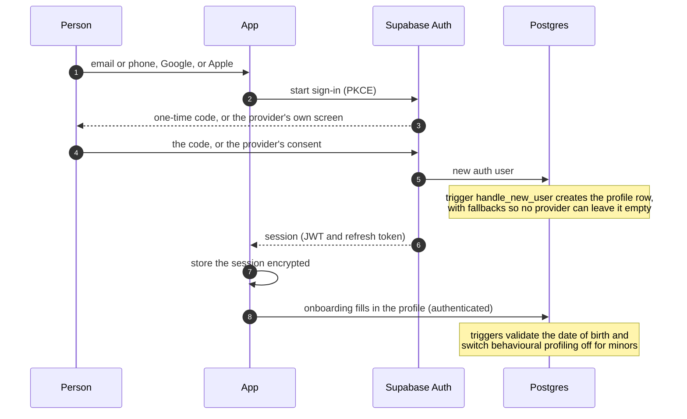

- **PKCE** means a redirect never carries a refresh token.
- The session is stored **encrypted at rest**: a 32-byte AES-256-GCM key in the device keychain and
  the larger payload in app storage under it. (A keychain entry alone cannot hold a session that
  carries provider tokens.)
- The profile row is created by the **database**, not the client, so every provider (including ones
  that return no name) yields a valid account.

## 2. Publishing a post

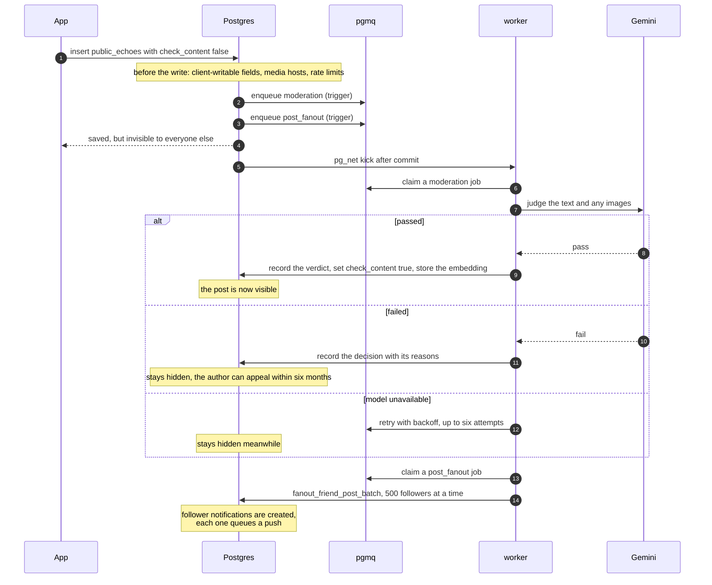

- **Publishing is fail-closed.** The row is created hidden (`check_content = false`) and only a
  passing verdict makes it visible. A throttled or unfunded AI key does not quietly weaken
  moderation: it stops publishing. That is the intended failure direction, and worth knowing before
  debugging "posts are not appearing".
- **A post costs the same to publish for 12 followers or 12 million.** The post queues exactly one
  fan-out job, and the worker expands it in keyset batches of 500; the unique `(user, echo)` key
  makes a retried batch a no-op.
- Offline, the insert goes through the device's [outbox](02-client-app.md#state-two-layers-and-an-outbox)
  and carries a client-supplied id, so a replay cannot create a duplicate.

## 3. Reading the feed

The ranking runs in SQL (`get_personal_feed`). The client asks for a page; the database decides.

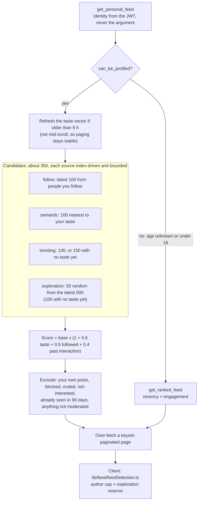

- **A user who cannot be profiled never reaches the personalised path.** Age is checked first, so
  the rule that under-18s get no behavioural profiling holds by construction, in Postgres, and fails
  closed on unknown age.
- The taste vector is the average embedding of the last 20 likes, else the user's chosen interests,
  else their last 20 posts, else nothing (and the personalised term scores zero). The strongest
  evidence wins: a like is what someone chose to consume; an interest is what they said; a post is
  only what they produced.
- **Author spread** (one voice cannot own the page) is applied in TypeScript because that rule is
  unit-tested there; SQL ranks, the client selects.
- Cost is bounded: the exclusions run once against about 350 candidate ids rather than the whole
  table, and the taste refresh scales with daily active users, not registered users.

## 4. A notification becoming a push

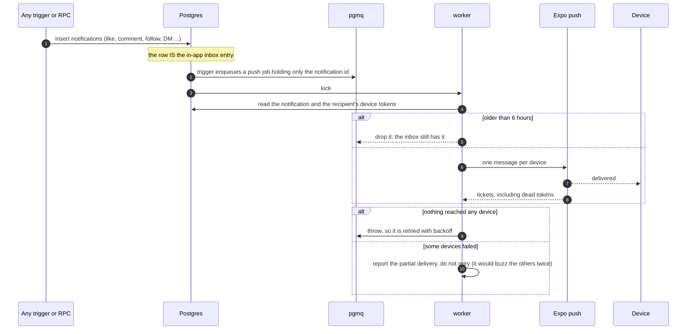

The in-app inbox is complete regardless of push, so dropping a stale or failed push loses nothing.
A tap, from a push or from the inbox, goes through one resolver
([`lib/notifications/tapTarget.ts`](../../lib/notifications/tapTarget.ts)).

## 5. Sending a direct message

One-to-one text is end-to-end encrypted: the server only stores ciphertext.

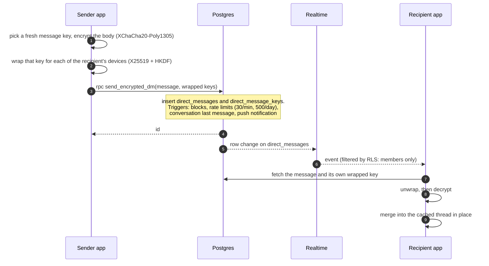

- The server sees **who** talks to whom, **when** and **how big**, but not **what**. There is no
  forward secrecy, and groups, photos and voice are not covered. The design and its limits are in
  [`docs/design/dm-e2ee.md`](../design/dm-e2ee.md).
- A push for an encrypted message carries **no preview**: the server has none to send.
- **Encryption cannot degrade quietly.** If a message cannot be sealed for every target device, the
  send **fails**; it never falls back to plaintext on an error. The one deliberate exception is a
  recipient who has not published a device key yet: then the message is sent unencrypted and the
  conversation shows **no lock**. The lock is derived from whether `ciphertext` is populated, so a
  regression that stops encrypting is visible to every user at once. (An earlier attempt silently
  fell back to plaintext and encrypted nothing for months; this is the lesson.)

## 6. Presence

A green dot and a coarse "last active", shown only between people who follow each other.

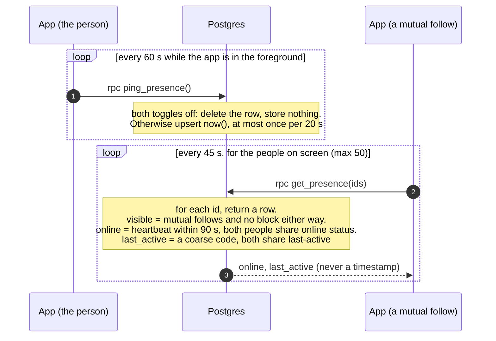

- **Privacy is enforced in the function, not the client.** A stranger, a one-way follower, a blocked
  person and someone who opted out all get an **identical** row ("offline, nothing to say"), so the
  function cannot be used to learn who follows whom or who blocked whom.
- **Two independent toggles:** *Online status* controls the dot, *Last active* controls the phrase.
  Reciprocity applies: if you share nothing, you see nothing.
- **No exact time ever leaves the server.** `last_active` is one of `recent` (under an hour),
  `today`, `yesterday`, `this_week`, or nothing.
- It replaced a single public channel that every client joined, which was an O(users) fan-out and
  could be read by anyone holding the public key. See
  [`docs/superpowers/specs/2026-10-16-presence-design.md`](../superpowers/specs/2026-10-16-presence-design.md).

## 7. Read receipts

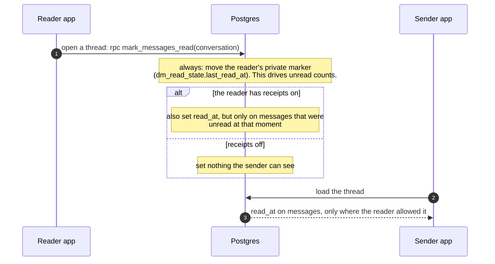

- What *you* have read is private and lives in your own marker, so unread counts and the "new
  messages" divider never depend on receipts.
- The "only on messages that were unread at that moment" rule matters: without it, switching
  receipts back **on** would turn every message you read privately while they were off into a visible
  receipt. The probe suite caught this during design.

## 8. Following a private account

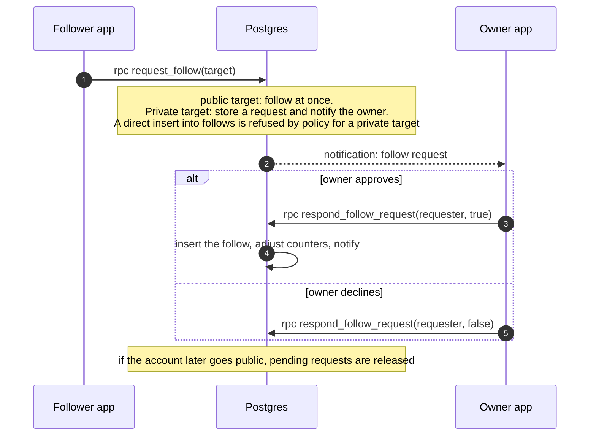

The rule lives in the `follows` insert policy and in these RPCs, so a modified client cannot follow
a private account by skipping the request. If the owner has blocked the requester, `request_follow`
still answers "requested" and creates nothing, so a block cannot be detected from the answer. Private accounts hide their echoes, comments and likes
from non-followers; the profile header itself stays visible.

## 9. Uploading and reading media

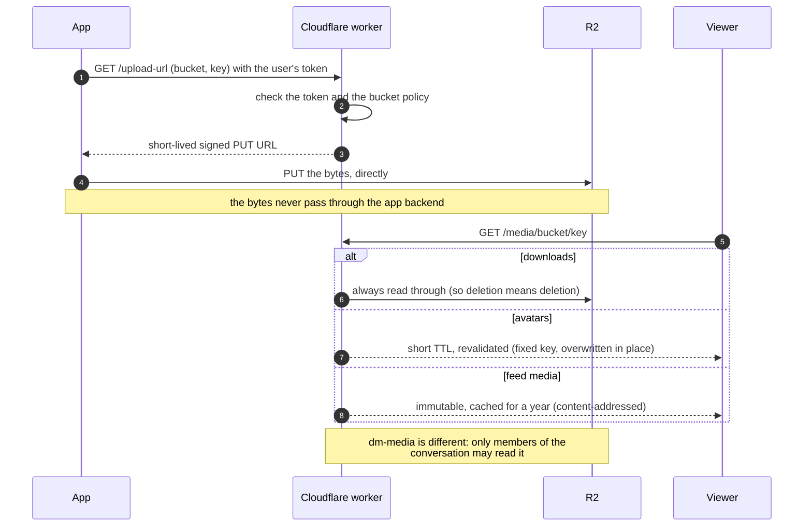

- The worker is the **only** thing that can mint upload signatures, so it is the single place that
  decides who may write where.
- Size ceilings are enforced **after** upload by a 15-minute sweep, because a presigned `PUT`
  cannot carry a length limit.
- Moderation of images happens when the *post* is judged, not at upload.

## 10. A voice command

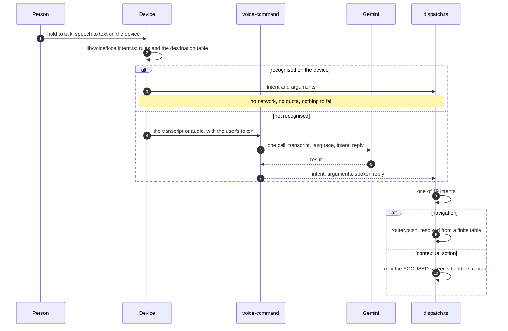

The device answers first, so navigation is instant and free; the model is consulted only for
phrasings the local table cannot resolve. Dictation fills a field and **never submits**, so a
mis-transcription cannot publish or reply on its own.

## 11. Deleting an account

Erasure has to reach every store, and finish even if a step fails.

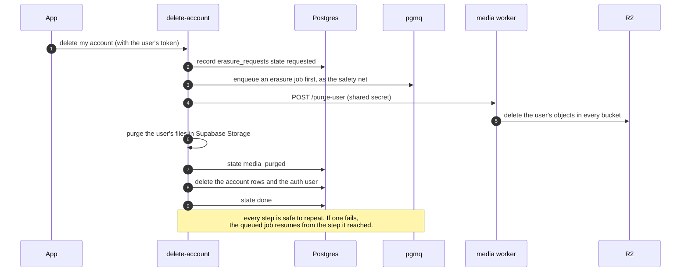

Deletion used to be a single request: a failure after the media purge ended in "contact support"
with a half-erased account. It is now a stored, resumable state machine whose steps are idempotent.
The flow probes check that, after deletion, **no row in any `public` table** still refers to the
user.

## 12. The daily question

The retention ritual: one question, the same for everyone, that closes.

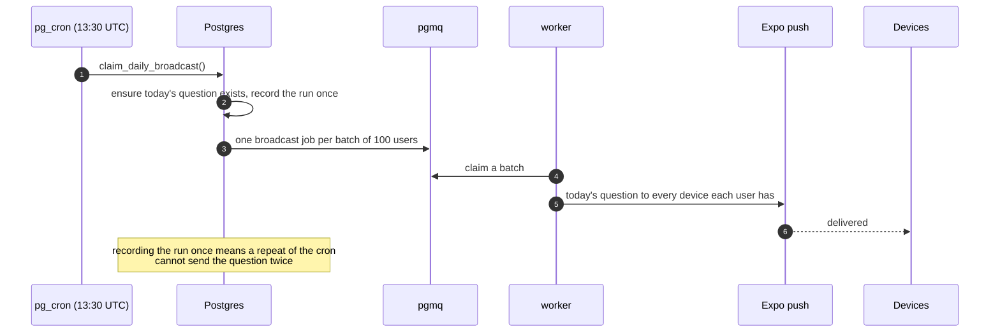

A late question is worse than none ("today's question" hours late is yesterday's), so a batch older
than six hours is dropped rather than sent.

[← Backend and data](03-backend-and-data.md) · [Index](README.md) · Next: [05 · Security and privacy](05-security-and-privacy.md)
