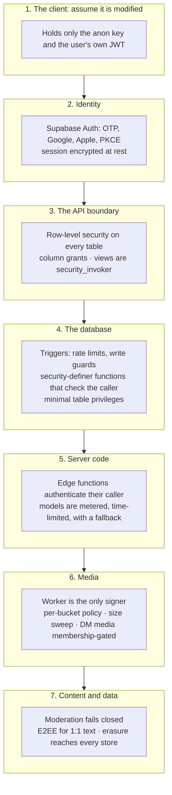

# 05 · Security and privacy

[← Key flows](04-key-flows.md) · [Index](README.md) · Next: [06 · Operations](06-operations.md)

How Echo defends itself and the people who use it, layer by layer, and, just as important, what it
does **not** claim. To report a vulnerability, see [`SECURITY.md`](../../SECURITY.md).

## The approach

Three rules explain most of the decisions here:

1. **Assume the client is hostile.** The app on a phone can be modified, so nothing the client
   decides is trusted. Every rule that protects someone is enforced where the client cannot reach it.
2. **Put the rule where it cannot be bypassed.** A check in the app is a courtesy; a check in a
   Postgres policy, trigger or function is a guarantee. Privacy features are built as the second kind.
3. **Fail closed, and make failure visible.** Moderation stops publishing rather than letting
   content through; encryption fails the send rather than falling back silently; a job that cannot
   finish lands in a queue a probe reports.

## Defence in depth

## Identity and sessions

- Sign-in is by one-time code (email or phone), Google or Apple, using **PKCE**: a custom-scheme
  redirect never carries a refresh token.
- The session on the device is **encrypted at rest**: an AES-256-GCM key in the keychain, the
  payload in app storage under it. GCM is authenticated, so tampering fails to decrypt. The
  cryptography is pure JavaScript, so it ships in an over-the-air update.
- Every profile is created by a database trigger with fallbacks, so no provider can leave an account
  half-made.
- **Age is enforced in the database.** A date of birth is validated by a trigger, is never
  selectable by a client, and under-18 accounts get no advertising and no behavioural profiling,
  which fails closed on unknown age.

## Authorisation

The full access model is on the [backend page](03-backend-and-data.md#the-access-model). The parts
that matter for security:

- `anon` is **read-only**. Neither client role can `TRUNCATE`, and default privileges are lowered so
  a new table does not regain the full grant set.
- Every table has row-level security, and policies read identity as `(select auth.uid())`.
- A function that takes a user id **must not trust it**: it checks `auth.uid()` (or the service role).
  Several past fixes were exactly this mistake.
- Anything that can bypass RLS (the service role, a `security definer` function) is kept small and
  pins its `search_path`.
- **Identity is never accepted from the caller where the JWT will do.** The personalised-feed
  function ignores its user-id argument and reads the identity from the token.

## Privacy by construction

These are the features where a promise to a person is kept by the database rather than the app:

| Promise | How it is kept |
|---|---|
| **A private account's content is private** | The `follows` insert policy refuses a private target; following goes through `request_follow`; comments and likes on a private author's posts are not readable by non-followers. A blocked requester gets the same answer as anyone else |
| **Only people who follow each other see your presence** | One function, `get_presence`, is the only way to read it. It checks mutual follows and blocks, honours both of *your* toggles and the viewer's own, and returns an **identical row** for "not allowed" and "offline", so it cannot be used to map who follows or blocks whom |
| **No exact "last seen" time exists to leak** | The server returns a coarse code (`recent`, `today`, `yesterday`, `this_week`), never a timestamp; a person who shares nothing has nothing stored |
| **Read receipts honour the toggle** | What you have read is your private marker. The sender sees a receipt only if you left receipts on, and only for messages unread at that moment |
| **Your date of birth is not readable** | It is granted for writing but never for selecting |
| **Minors are not profiled** | Eligibility is the first check in the personalised feed, in SQL |
| **Deleting your account deletes it** | Erasure is a stored, resumable state machine that purges R2, Storage, the account rows and the auth user, with the flow probes asserting no `public` row remains |
| **A direct message is yours** | One-to-one text is sealed on the device; the server holds ciphertext and no preview is sent in a push |

## End-to-end encryption

One-to-one text messages (and links, contacts and shared-Echo messages) are sealed on the sender's
device to each of the recipient's registered devices: a fresh message key per message, encrypted with
XChaCha20-Poly1305, wrapped per device with an ephemeral X25519 key and HKDF-SHA256. Each layer binds
its context (message, conversation, sender, device) as associated data, so the server cannot
re-attribute a message. Implementation: [`lib/e2ee/`](../../lib/e2ee/). Design and threat model:
[`docs/design/dm-e2ee.md`](../design/dm-e2ee.md).

**What it protects against:** anyone who can read the database or its backups: staff, a stolen
service-role key, a platform compromise, a legal demand served on Echo.

**What it does not, and must not be described as doing:**

- **A compromised device.** Malware, or physical access to an unlocked phone, reads messages after
  decryption.
- **Forward secrecy.** Identity keys are long-lived: if a device's key is extracted, past messages
  delivered to it become readable. A ratchet would fix this and is deliberately deferred.
- **Metadata.** Who talks to whom, when, how often and how large stay visible to the server.
- **Anything but one-to-one text.** Photos, voice, group chats and messages from before it shipped
  are not encrypted.
- **Server-side features.** The server cannot search, preview or moderate sealed content; a message
  is disclosed to moderators only when a participant reports it.

## Abuse resistance

| Threat | Control |
|---|---|
| Flooding (spam posts, comments, follows, DMs) | Per-user rate limits in triggers on about twenty-five tables, short and long windows; a client cannot skip them |
| Unfunded or abused AI | Every branch that can reach a model is metered; every provider attempt has a 25-second timeout; a failing provider falls back to a second one behind a circuit breaker |
| Oversized uploads | Per-bucket size ceilings, enforced by a sweep, touching only user-owned keys |
| Harmful content | Moderation fails closed: a post is hidden until a classifier passes it; text *and* uploaded images are judged; reports, a moderator role, statements of reasons and a six-month appeals window |
| Account takeover of the data path | RLS plus column grants plus identity-from-JWT; no client-supplied identity |
| Replay and double-processing | Idempotent job handlers and client-supplied ids; a retried job cannot duplicate its effect |

## Secrets

- **The client carries no secret.** The anon key is public by design; the service-role key is
  server-side only and has been checked absent from the release bundle, the OTA bundle and the web
  export.
- **Server secrets** live in Supabase function secrets, in **Vault** for values the database itself
  needs to authenticate a call to a function, and in the CI provider's secret store. Nothing is in
  the repository, and secret scanning runs on every pull request.
- **Calls between our own components are authenticated.** The database proves itself to the worker
  and to the cron-driven functions with a shared secret compared in constant time; the payment
  webhooks verify a signature; the media worker's internal routes require a purge secret.

## Dependencies and the supply chain

- Edge functions import their dependencies by URL or npm specifier, and every one pins an exact version (a test fails on a floating range), so a deploy cannot silently pull in an untested release.
- `npm audit` findings are in build and test tooling (Metro, Jest, Tailwind, the Expo CLI), and the
  vulnerable packages were checked against the shipped bundle's source map and are not in it.
  `npm audit fix --force` must not be run: it downgrades the router to a different major version.
- `NOTICE` and `sbom.json` record third-party attribution and licence elections
  (`npm run legal:sbom`). CodeQL and secret scanning run on pull requests.

## What Echo does not claim

Stated plainly, because each is easy to assume the other way:

- **No end-to-end encryption beyond one-to-one text.**
- **No visual moderation of video.** Text and still images pass an LLM gate; a still-image model
  cannot read an mp4.
- **No metadata privacy.** The server knows who messages whom.
- **No claim of being unbreakable.** Defence in depth reduces risk; it does not remove it. Report
  what you find.
- **The legal documents are drafts** pending counsel review (see the README).

[← Key flows](04-key-flows.md) · [Index](README.md) · Next: [06 · Operations](06-operations.md)
