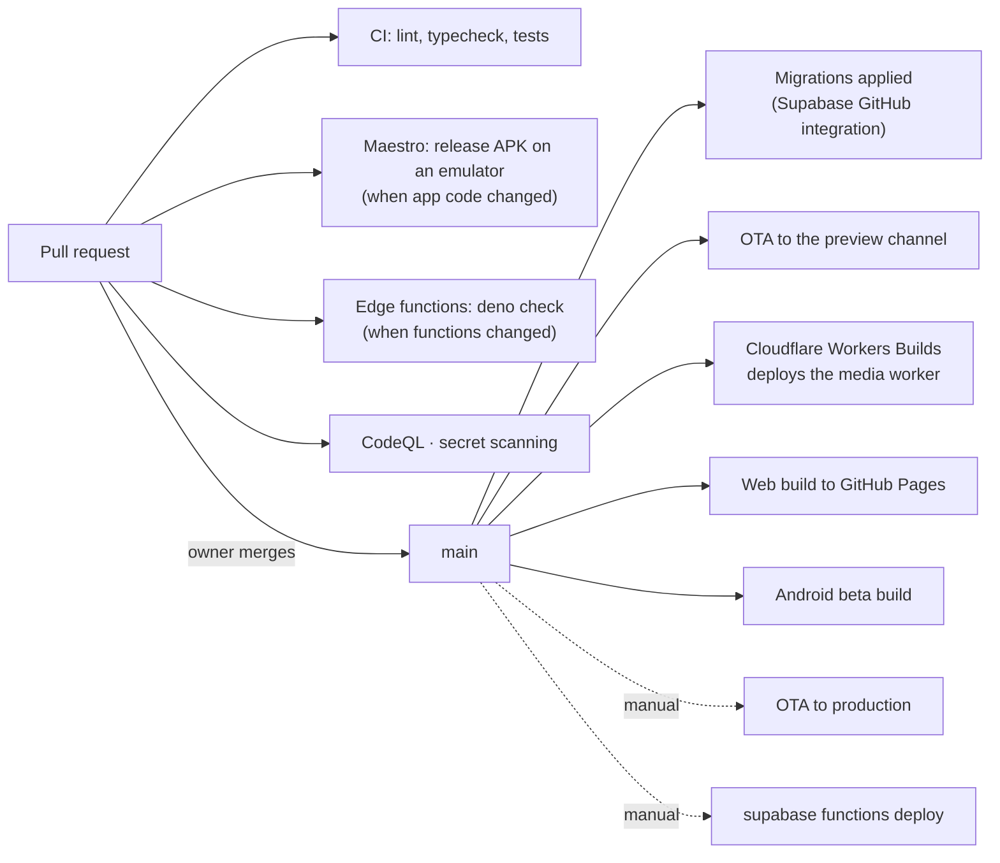

# 06 · Operations

[← Security and privacy](05-security-and-privacy.md) · [Index](README.md) · Next: [07 · Decision log](07-decision-log.md)

How the system is built, shipped, watched and recovered. For the day-to-day runbooks, see
[`docs/runbook/`](../runbook/).

## Environments

| | Where | Used for |
|---|---|---|
| **Local** | Your machine; optionally a prod-shaped Supabase stack in Docker | Development, and the flow probes (`npm run probe:flows`) |
| **Preview** | An EAS Update branch, `preview`, published automatically on every push to `main` | Seeing a change on a device before it reaches users |
| **Production** | The Supabase project, the Cloudflare worker, the `production` update channel | The app people use |

There is one production database; there is no separate staging database. This is why a migration is
validated against the **live** schema in a rolled-back transaction before it merges.

## CI/CD at a glance



| Workflow | Trigger | Does |
|---|---|---|
| `ci.yml` | push and PR to `main` | `lint`, `typecheck` and the full test suite |
| `maestro-e2e.yml` | PRs that change app code | Builds a release APK and runs the cold-launch flow on an emulator (about 40 minutes) |
| `functions.yml` | PRs and pushes touching functions | Type-checks every function with Deno. Its deploy job (migrations then functions) is wired but **disabled** until a project reference is configured, so functions are deployed by hand |
| `ota-update.yml` | push to `main` | Publishes an over-the-air update to the **preview** channel |
| `android-beta.yml` | push to `main` | Prebuilds and signs an Android build |
| `play-closed-test.yml` | manual | Builds the app bundle and, if asked, uploads it to the Play closed-test track |
| `gh-pages.yml` | push to `main` | Exports the web app and publishes it to GitHub Pages |
| `healthcheck.yml` | every 15 minutes | Synthetic checks (see [Monitoring](#monitoring)) |
| `db-backup.yml` | nightly, 01:45 IST | Logical dump to R2, then proves it restores (see [Backups](#backups-and-recovery)) |

The media worker deploys itself: Cloudflare Workers Builds deploys it from the **root**
`wrangler.toml` on every push to `main`. A second copy in `cloudflare/` is what a hand deploy reads;
a test fails if the two drift.

Merging is explicit: the owner merges each pull request.

## Shipping a change

What reaches users, and how, depends on what changed:

| What changed | How it ships | Time to users |
|---|---|---|
| **JavaScript, styles, copy** | An over-the-air update to the production channel (`eas update`) | Next app launch, applied on the one after |
| **A database migration** | Applied automatically when merged | About a minute |
| **An edge function** | `supabase functions deploy` | Immediate |
| **The media worker** | Automatic on merge | Minutes |
| **Native code or config** (a new native module, `app.json`, a plugin) | A new store build | Days: store review |

### Over-the-air updates and the fingerprint

`app.json` sets `runtimeVersion: { policy: "fingerprint" }`. The runtime version is a **hash of
everything native** in a build, so an update only reaches builds it is compatible with. Two
consequences:

- Adding a native dependency, or changing native config, **changes the fingerprint**. Installed
  builds keep their old fingerprint and stop receiving updates until users install the new build.
  Batch native changes into planned builds; do not trigger one per fix.
- Builds in the field can have **several fingerprints at once** (iOS, Android, and older Android
  builds). Each needs the same JavaScript published for its own runtime, or those users silently stay
  on old code. Always check the runtime version printed when publishing.

An update downloads on launch and applies on the next launch.

### Rolling back

| Layer | How |
|---|---|
| Over-the-air update | Republish the previous good commit's bundle to the same channel |
| Edge function | Redeploy the previous commit's functions (there is no per-version rollback in the CLI) |
| Migration | Forward only: write a corrective migration. Destructive steps are gated until old builds are gone |
| Feature | Flip its flag (see below), which takes effect without any release |

## Feature flags and the kill switch

Flags are rows in `feature_flags`, layered over defaults compiled into the app (see
[the client page](02-client-app.md#feature-flags-and-the-kill-switch)). Turning a feature off is one
row update; clients pick it up on their next fetch. Because the compiled default wins when the table
is unreachable, a bad network cannot turn the app into one with no features.

## Monitoring

Three independent layers, so one silent failure cannot hide the others:

| Layer | What it asks | Frequency |
|---|---|---|
| **`healthcheck.yml`** (outside the system) | Do the REST API, the media worker, an edge function and the public legal pages answer? Is `cron_health()` unhealthy? | every 15 minutes |
| **`ops-probe`** (inside the system) | Does the product still *work*, not merely did the jobs run? It asserts outcomes, then alerts moderators by push and email | every 30 minutes |
| **`cron_health()`** | Each cron job's recent result, the dead-letter queue depth, and any job left waiting | on demand, and read by the two above |

The bug class this guards against is the **silently dead job**: a cron that reports success while
doing nothing (a missing secret, a missing foreign key, an empty queue). Verifying a job means
asserting its *outcome*, which is why `npm run audit:backend` calls each RPC for real rather than
trusting a green status.

Crash reports go to Sentry and product analytics to PostHog, both behind the consent banner.

## Backups and recovery

| Layer | What | Notes |
|---|---|---|
| **Nightly logical dump** | `pg_dump` to R2, 01:45 IST, then a restore test | The workflow fails if the dump does not restore, so a backup that cannot be used is noticed the next morning |
| **Supabase backups** | Daily, kept for a week | Platform-managed |
| **Recovery bundle** | [`supabase/recovery/`](../../supabase/recovery/README.md) | Rebuilds an empty database from the repository: schema snapshot, auth and storage objects, queues, cron jobs and seed content, in about a second. Secrets are never in it; the script lists what must be set by hand |

The recovery point is the last nightly dump. Recovering also means re-creating the Vault entries and
function secrets, deploying the functions, and pointing the app and the media worker at the new
project; the recovery README is the runbook. Encrypted direct messages restore as ciphertext: the keys
are on people's devices, not in any backup.

## Secrets and configuration

| Kind | Where it lives |
|---|---|
| Public client variables | `.env` locally (template: `.env.example`); EAS and CI environment for builds |
| Server secrets for functions | `supabase secrets set` |
| Secrets the database needs to call a function | Supabase **Vault** (read by `pg_net` calls in SQL) |
| CI secrets | GitHub Actions secrets and variables |
| Native signing keys | Never in the repository |

## Local development

```bash
npm ci
cp .env.example .env     # public client variables
npm start                # then press i, a or w
npm run typecheck && npm run lint && npm test
npm run probe:flows      # needs the local Supabase stack running
```

`android/` and `ios/` are generated by `expo prebuild` and gitignored. Native behaviour is configured
in `app.json`, `app.config.js` and `plugins/`: never edit the generated projects. Android builds need
JDK 17 (newer JDKs fail the native configure step with a misleading message); see
[`docs/deployment/android-build.md`](../deployment/android-build.md).

## Runbooks

| Runbook | For |
|---|---|
| [`docs/runbook/monitoring.md`](../runbook/monitoring.md) | Reading the health signals and what to do about each |
| [`docs/runbook/e2ee-rollout.md`](../runbook/e2ee-rollout.md) | The encryption rollout and what may be claimed publicly |
| [`supabase/recovery/README.md`](../../supabase/recovery/README.md) | Rebuilding the database |
| [`docs/deployment/android-build.md`](../deployment/android-build.md) | Building Android locally |

[← Security and privacy](05-security-and-privacy.md) · [Index](README.md) · Next: [07 · Decision log](07-decision-log.md)
