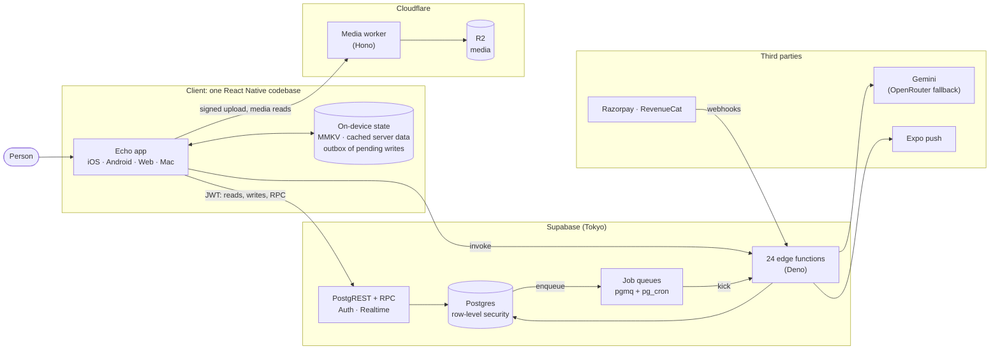

# Echo architecture

How Echo is put together, written so that someone who has never seen the code can follow it, and
someone who knows it can check it. Start with the picture below, then read the pages in order or
jump to the one you need.

> **What Echo is.** A voice-first social app. You speak; one model call turns the recording into a
> transcript, an intent and a spoken reply, and the app acts on it. The whole interface is
> localised into 26 languages, including right-to-left layouts. One codebase ships to iOS, Android,
> web and a Mac desktop shell, backed by Supabase.

## The system on one page

Three ideas explain most of the design:

1. **The database is the rulebook.** Who may read or write what, how often, and what happens as a
   consequence are enforced in Postgres (row-level security, triggers, functions), not in the app.
   A modified client can therefore reach exactly what its login allows, and nothing else.
2. **Side effects are queued, not chained.** A post, a message or a purchase never calls a slow or
   flaky service from inside the request. It writes a row and enqueues a job; a worker does the
   rest, retries it, and dead-letters it if it never succeeds.
3. **The device works without the network.** Writes that must survive a dead connection go through
   an outbox; direct messages live in a local database; server state is cached on the device.

## Reading order

| Page | Read it to learn | Time |
|---|---|---|
| [01 · System overview](01-system-overview.md) | The components, where each runs, who trusts whom, and where data lives | 8 min |
| [02 · The client app](02-client-app.md) | How the app is structured: routing, state, offline, voice, flags, performance | 10 min |
| [03 · Backend and data](03-backend-and-data.md) | The data model, the access rules, the job system, cron, edge functions, storage | 12 min |
| [04 · Key flows](04-key-flows.md) | Step-by-step sequence diagrams for the flows that matter most | 12 min |
| [05 · Security and privacy](05-security-and-privacy.md) | The defences, layer by layer, and what Echo does **not** claim | 8 min |
| [06 · Operations](06-operations.md) | Environments, CI/CD, shipping updates, monitoring, backups, recovery | 8 min |
| [07 · Decision log](07-decision-log.md) | Why it is built this way, and what each choice cost | 10 min |

Related documents elsewhere in the repository:

| Document | About |
|---|---|
| [`docs/design/dm-e2ee.md`](../design/dm-e2ee.md) | The end-to-end encryption design and its threat model |
| [`docs/superpowers/specs/2026-10-16-presence-design.md`](../superpowers/specs/2026-10-16-presence-design.md) | Presence and read receipts: design and privacy analysis |
| [`docs/runbook/`](../runbook/) | Operational runbooks: monitoring, the E2EE rollout |
| [`docs/deployment/android-build.md`](../deployment/android-build.md) | Building the Android app locally |
| [`supabase/recovery/README.md`](../../supabase/recovery/README.md) | Rebuilding an empty database from the repository |
| [`docs/compliance/`](../compliance/) | Legal and regulatory notes |

## Glossary

| Term | Meaning here |
|---|---|
| **RLS** | Row-level security. Postgres checks a policy for every row a query touches, using the caller's identity. |
| **RPC** | A database function the client calls through PostgREST, for example `get_presence`. |
| **Security definer** | A function that runs with its owner's rights rather than the caller's. Every one in Echo pins its `search_path` and checks who is calling. |
| **JWT** | The signed login token the client sends. `auth.uid()` in SQL reads the user id out of it. |
| **Service role** | A server-only key that bypasses RLS. It never ships in the app. |
| **pgmq** | A message queue implemented inside Postgres. Echo has ten queues (see the backend page). |
| **Worker** | The edge function that drains those queues. Not to be confused with the Cloudflare media worker. |
| **DLQ** | Dead-letter queue: where a job lands after it has failed too many times, so a person can look. |
| **Outbox** | A device-side list of writes made offline, replayed in order when the network returns. |
| **OTA** | Over-the-air update: a new JavaScript bundle delivered to installed apps without a store release. |
| **Fingerprint (runtime version)** | A hash of everything native in a build. An OTA bundle only reaches builds with the same fingerprint. |
| **Feature flag / kill switch** | A remote on/off value layered over a default compiled into the app. |
| **E2EE** | End-to-end encryption: only the sender's and recipient's devices can read a message. |
| **PKCE** | The sign-in flow variant that never puts a refresh token in a redirect URL. |

## How these pages were written

Every concrete claim (counts, names, schedules, limits) was read from the code or the live database
rather than remembered, and each page says where to look to re-check it. **When something here
disagrees with the code, the code is right**: fix the page. Counts drift fastest, so the
[README's "What's built"](../../README.md#whats-built) table says when it was last re-derived.

Diagrams are [Mermaid](https://mermaid.js.org/), which GitHub renders directly from the source: edit
the text, not an image.
